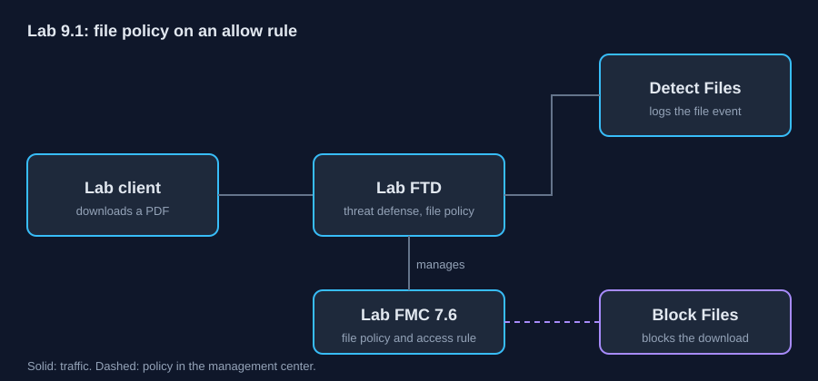

# Lab: Attach a file policy and prove it works

Video: [Cisco FMC & FTD: File Policies and Network Malware Protection](https://youtu.be/UOPNjTjE294)
Reference: Cisco Secure Firewall Management Center Device Configuration Guide 7.6,
chapter 64 (PDF pages 2293-2302, 2312-2326). Check the guide for your exact version.

> **Use a lab FMC/FTD or a virtual lab, never production.**

## Goal

See what a file policy does and what it needs. You create a file policy with a Detect Files rule for PDF downloads, attach it to an allow rule, find the file event, switch to Block Files, then remove the policy and confirm no file events appear.

## Background

- An access control rule that allows HTTPS or SMB says nothing about what travels inside those connections. A malicious executable can ride a permitted port to an internal server. File policies let the firewall look at the files inside allowed traffic and decide what to do, by type and, with the right license, by malware disposition.
- File control identifies the type of a file (executable, PDF, archive) from its content signature, not the extension, and does not judge whether it is safe. Network malware protection assesses whether a file is malicious, usually by sending its SHA-256 hash to the AMP cloud for a disposition.
- File rule actions: Detect Files logs that a file was seen (IPS license); Block Files blocks the selected types (IPS); Malware Cloud Lookup gets and logs the disposition but still allows the transfer (IPS plus Malware Defense); Block Malware queries the cloud and blocks files whose disposition is malware (IPS plus Malware Defense).
- Build a file policy in three steps: create the policy (the container), add file rules (application protocol, direction, file types or categories) and choose the action. The advanced option Inspect Archives lets the system inspect archive contents, but it does nothing in a policy with no file rules.
- A file policy does nothing on its own. It must be attached to an access control rule that permits traffic (Allow or Interactive Block) and deployed; inspection happens on the managed device.
- Retrospective events: if a file was allowed as unknown or clean and the cloud later classifies it as malware, the system generates a retrospective event so you can find the hosts that received it.

## Prerequisites

- A lab management center and threat defense with the IPS license (and Malware Defense if you will test malware actions).
- A lab client and a lab web server that serves a harmless PDF.

Values you will use (keep them as placeholders in anything you share, never commit real values):

| Placeholder | What it is |
|---|---|
| `<FILE_POLICY>` | the lab file policy |
| `<ACP_NAME>` | the lab access control policy |
| `<CLIENT_IP>` | the lab client |
| `<WEB_SERVER>` | the lab web server |

## Steps

### Part 1: detect

1. Confirm the license on the lab device.
2. Create `<FILE_POLICY>` with one Detect Files rule for PDF downloads over HTTP.
3. Attach it to an allow rule in `<ACP_NAME>` for `<CLIENT_IP>` to `<WEB_SERVER>` and deploy.
4. Download a PDF and find the file event.

### Part 2: block

5. Change the rule to Block Files, deploy and confirm the download fails and a file event shows the block.

### Part 3: orphaned policy

6. Remove `<FILE_POLICY>` from the access control rule, deploy and confirm no file events appear.

## Where this lab follows the documentation

Blocking or allowing files by type needs the IPS license on threat defense, while the Malware Cloud Lookup, Block Malware and file storage options need IPS plus Malware Defense. Export-controlled functionality is a requirement of strong-crypto features such as decryption and remote access VPN, not of file policies.

## Check your work

Use [checklist.md](checklist.md). If something does not work, start with
[troubleshooting.md](troubleshooting.md).

## Clean up

Delete the lab file policy and restore the access control rule, then deploy again.

---
*Always confirm behavior against the guide for your exact FMC/FTD version. Independent training by Hexward Labs; not affiliated with or endorsed by Cisco Systems.*
