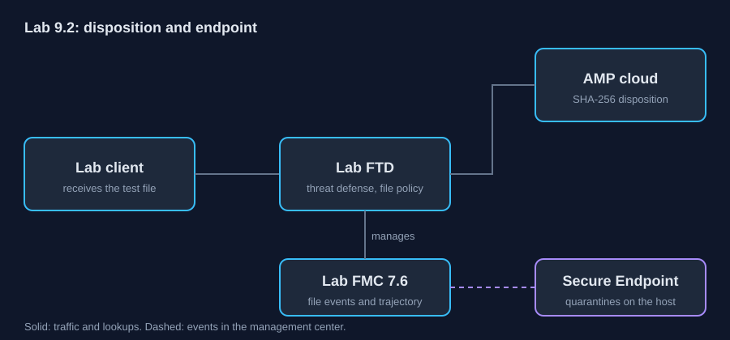

# Lab: Follow a file's disposition

Video: [Cisco FMC & FTD: Cloud Analysis, Retrospective Events, and Secure Endpoint](https://youtu.be/rtjhscCVd_U)
Reference: Cisco Secure Firewall Management Center Device Configuration Guide 7.6,
chapter 64 (PDF pages 2303-2311, 2327-2334). Check the guide for your exact version.

> **Use a lab FMC/FTD or a virtual lab, never production.**

## Goal

Trace what happens to a file after it crosses the firewall. You check the AMP cloud connection, download a harmless test file, find its hash and disposition, open the file trajectory to see which hosts got it, and identify which component would act on the host.

## Background

- New malware is often unknown when it first crosses the firewall. A file allowed at 08:00 as Unknown may be classified as malware at 11:00 when it is already on a laptop. You need to know which hosts received it and you need endpoint tooling to act on them.
- Cloud options: the AMP public cloud returns dispositions by SHA-256 hash (regional clouds exist); an AMP private cloud serves organizations that cannot send lookups to the public cloud; Secure Malware Analytics (cloud or on-premises) runs eligible files in a sandbox and returns a threat score.
- Retrospective events are generated when the cloud changes a file's disposition after the file has passed. Because file events record which hosts transferred the file, you can see which hosts were exposed.
- Network versus endpoint: the firewall sees the file on the wire but cannot act on the host after the file lands. Secure Endpoint runs on the host and can quarantine according to its own policy; integration brings both views together.
- Detailed analysis reports are available only to the organization that submitted the file. Associating the management center with your Secure Malware Analytics account lets you open them; the documentation notes association can take up to 24 hours.

## Prerequisites

- A lab management center and threat defense with Malware Defense licensing (never production).
- A harmless test file source. Optional: a Secure Endpoint lab tenant.

Values you will use (keep them as placeholders in anything you share, never commit real values):

| Placeholder | What it is |
|---|---|
| `<FILE_POLICY>` | the lab file policy with Block Malware |
| `<TEST_FILE>` | a harmless test file |
| `<FILE_SHA256>` | the SHA-256 hash shown in the file event |

## Steps

### Part 1: connection and policy

1. Check the AMP cloud connection status on the management center.
2. In a rule of `<FILE_POLICY>` using Block Malware, enable the dynamic analysis options available in your version.

### Part 2: follow the file

3. Download `<TEST_FILE>` and find its file event and `<FILE_SHA256>`.
4. Open the file trajectory for that hash and note which hosts are listed.

### Part 3: endpoint view

5. If you have a Secure Endpoint lab tenant, add the Secure Endpoint cloud connection and confirm endpoint-based events appear.
6. Write down which component would quarantine the file on a host (Secure Endpoint, not the firewall).

## Where this lab follows the documentation

The setting for access to dynamic analysis results associates your management center with your Secure Malware Analytics account so you can view detailed file analysis reports; retrospective malware events come from the AMP cloud connection and your file policies. The firewall does not quarantine files on endpoints: quarantine is done by Secure Endpoint according to its own policy. Integrating the management center with Secure Endpoint lets it import endpoint-based events (scans, detections, quarantines, blocked executions, indications of compromise).

## Check your work

Use [checklist.md](checklist.md). If something does not work, start with
[troubleshooting.md](troubleshooting.md).

## Clean up

Remove the lab integration entries and file policy settings, then deploy again.

---
*Always confirm behavior against the guide for your exact FMC/FTD version. Independent training by Hexward Labs; not affiliated with or endorsed by Cisco Systems.*
