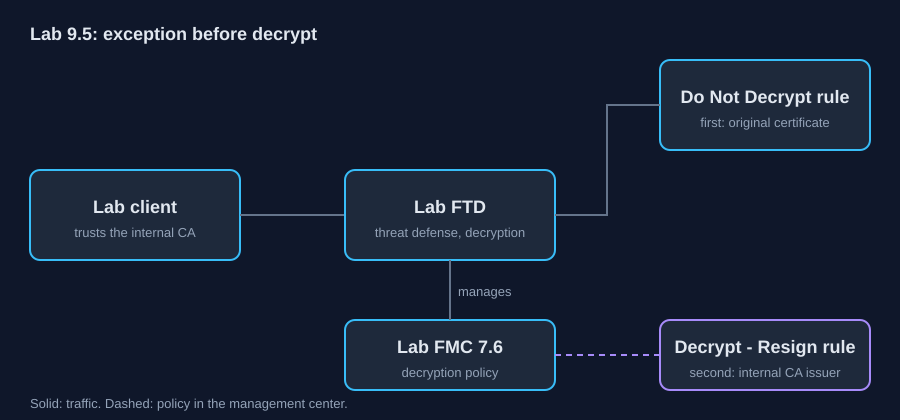

# Lab: Build a Do Not Decrypt exception before the broad rule

Video: [Cisco FMC & FTD: Decryption Rules: Conditions and Actions](https://youtu.be/IxMPlsFxnAg)
Reference: Cisco Secure Firewall Management Center Device Configuration Guide 7.6,
chapter 67 (PDF pages 2385-2418). Check the guide for your exact version.

> **Use a lab FMC/FTD or a virtual lab, never production.**

## Goal

Keep decryption useful instead of disruptive. You create a Decrypt - Resign rule for one lab client, add a Do Not Decrypt rule above it for one site, compare the certificate issuer in the browser, then swap the order and restore it.

## Background

- One badly placed decryption rule can break a business application for everyone. Applications that pin their server certificate refuse a re-signed certificate, and some traffic should never be decrypted for privacy or compliance reasons.
- Prerequisites: outbound decryption needs an internal CA certificate object (generated on or uploaded to the management center) that clients trust; inbound decryption of your own servers needs the server's certificate and private key.
- Limitations to check first: certificate pinning (use Do Not Decrypt), TLS 1.3 (follow the guide's best practices for your version) and anonymous cipher suites or other undecryptable cases (handled by the policy's undecryptable actions).
- Rule conditions combine zones, networks, VLAN tags, users, applications, ports, URL categories, certificate distinguished names, certificate status and cipher suites.
- Actions: Monitor forces connection logging and evaluation continues; Do Not Decrypt passes the connection without decrypting it; Block and Block with reset block the encrypted connection; Decrypt - Resign handles outbound traffic to external servers with your internal CA; Decrypt - Known Key handles inbound traffic to servers you own.
- Rules are evaluated top-down and the first matching rule other than Monitor decides, so exceptions go above broad decrypt rules.

## Prerequisites

- A lab management center and threat defense with export-controlled functionality enabled in the lab (never production).
- A lab client that trusts your lab internal CA and two test sites.

Values you will use (keep them as placeholders in anything you share, never commit real values):

| Placeholder | What it is |
|---|---|
| `<INTERNAL_CA>` | the lab internal CA object |
| `<DECRYPT_POLICY>` | the lab decryption policy |
| `<ACP_NAME>` | the lab access control policy |
| `<CLIENT_SUBNET>` | the lab client network |
| `<EXCEPTION_SITE_DN>` | the distinguished name of the excluded lab site |
| `<SITE_ONE>` | the excluded test site |
| `<SITE_TWO>` | a normal test site |

## Steps

### Part 1: build the rules

1. Generate or upload `<INTERNAL_CA>` and trust it on one lab client.
2. Create `<DECRYPT_POLICY>` with a Decrypt - Resign rule for `<CLIENT_SUBNET>`.
3. Above it add a Do Not Decrypt rule matching `<EXCEPTION_SITE_DN>`.
4. Associate the policy with `<ACP_NAME>` and deploy.

### Part 2: compare

5. Browse to `<SITE_ONE>` and `<SITE_TWO>` and compare the certificate issuer shown in the browser.
6. Check the connection events for the decryption result of each.

### Part 3: swap and restore

7. Swap the two rules, deploy and observe the change; then restore the correct order.

## Where this lab follows the documentation

The informational, alert, error and fatal counters are TLS/SSL hardware acceleration counters read on the device CLI with `show snort tls-offload` and `show counters` (fatal counters should be at or near zero on a healthy system), not decryption counters shown by the management center. To confirm that a specific connection was decrypted or bypassed use connection events with the TLS and decryption fields. The Monitor action forces connection logging and the connection then continues to be evaluated by the rules below it.

## Check your work

Use [checklist.md](checklist.md). If something does not work, start with
[troubleshooting.md](troubleshooting.md).

## Clean up

Remove the lab decryption policy from the access control policy and deploy again.

---
*Always confirm behavior against the guide for your exact FMC/FTD version. Independent training by Hexward Labs; not affiliated with or endorsed by Cisco Systems.*
