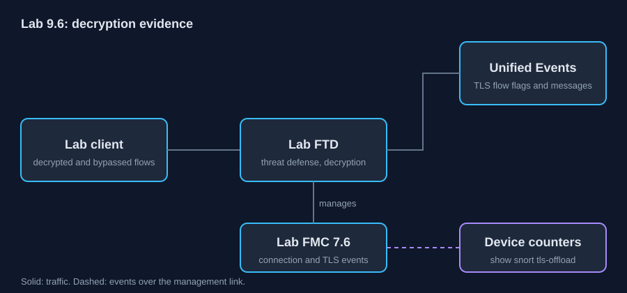

# Lab: Read the evidence when decryption fails

Video: [Cisco FMC & FTD: Monitoring and Troubleshooting Decryption](https://youtu.be/X5Xneakk4i4)
Reference: Cisco Secure Firewall Management Center Device Configuration Guide 7.6,
chapter 67 (PDF pages 2419-2432). Check the guide for your exact version.

> **Use a lab FMC/FTD or a virtual lab, never production.**

## Goal

Know where to look when TLS decryption breaks. You add TLS fields to Unified Events, generate decrypted and non-decrypted connections, compare them, read the device counters, confirm the management connection and write a one-page runbook.

## Background

- When TLS decryption fails, users see broken applications and the help desk sees a flood of tickets, while the firewall may be blind to the traffic it was meant to inspect. Troubleshooting depends on knowing where to look: events on the management center, counters on the device and the usual causes.
- TLS/SSL hardware acceleration counters (device CLI: `show snort tls-offload`, `show counters`): informational (normal activity), alert (worth watching), error (may affect connections) and fatal (should be at or near 0 on a healthy system).
- Common causes: certificate pinning (the client rejects the re-signed certificate; fix with Do Not Decrypt for that application); untrusted or invalid certificates; no cipher suite in common; TLS heartbeat handling; and oversubscription when decryption demand exceeds what the platform can process.
- Events reach the management center over the management connection, a TLS 1.3-encrypted two-way channel. If it is down the device still enforces policy but you will not see new events centrally.

## Prerequisites

- A lab management center and threat defense with a working decryption policy (never production).
- A lab client that can reach one decrypted and one non-decrypted site.

Values you will use (keep them as placeholders in anything you share, never commit real values):

| Placeholder | What it is |
|---|---|
| `<CLIENT_IP>` | the lab client |
| `<DECRYPTED_SITE>` | a site covered by a decrypt rule |
| `<BYPASSED_SITE>` | a site covered by Do Not Decrypt |

## Steps

### Part 1: events

1. In Unified Events add the TLS Flow Flags and TLS Flow Messages columns.
2. From `<CLIENT_IP>` generate connections to `<DECRYPTED_SITE>` and `<BYPASSED_SITE>`.
3. Compare the TLS fields for each connection.

### Part 2: device

4. On a lab device with TLS hardware acceleration run `show snort tls-offload` and note the counters.
5. Confirm the device's management connection to the management center is up so events arrive.

### Part 3: runbook

6. Write a short runbook: symptom, where to look, likely cause, fix.

## Where this lab follows the documentation

Crypto archives are not a general place to confirm that a Do Not Decrypt fix worked: they exist only on certain hardware, store crypto session information on the device and are decoded with debug tools, typically together with TAC. To confirm a fix use connection events with the TLS flow fields. TLS oversubscription is detected in Unified Events (TLS Flow Flags OVER_SUBSCRIBED, with ERROR_EVENT_TRIGGERED) and on the device (BYPASS_NOT_ENOUGH_MEM in `show counters` or `show snort tls-offload`); how those connections are handled depends on the policy's undecryptable actions. Remedies are Do Not Decrypt rules for lower-priority encrypted traffic or a larger device. The counters are TLS/SSL hardware acceleration counters read on the device CLI, not a management center page.

## Check your work

Use [checklist.md](checklist.md). If something does not work, start with
[troubleshooting.md](troubleshooting.md).

## Clean up

Remove the lab columns and notes if you do not need them.

---
*Always confirm behavior against the guide for your exact FMC/FTD version. Independent training by Hexward Labs; not affiliated with or endorsed by Cisco Systems.*
