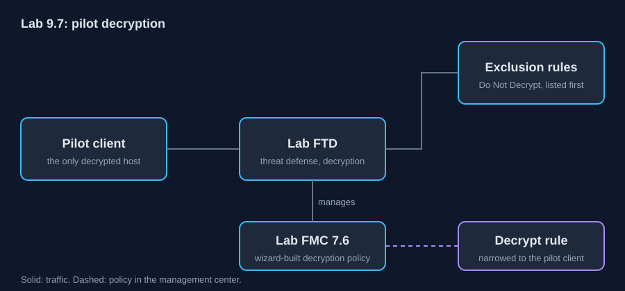

# Lab: Pilot decryption on one host with the wizard

Video: [Cisco FMC & FTD: Decryption Examples, Exceptions, and ACP Integration](https://youtu.be/hgYRSQkpIKY)
Reference: Cisco Secure Firewall Management Center Device Configuration Guide 7.6,
chapter 68 (PDF pages 2433-2450). Check the guide for your exact version.

> **Use a lab FMC/FTD or a virtual lab, never production.**

## Goal

Get visibility without an outage. You create a lab internal CA, run the wizard with exclusions, check that the Do Not Decrypt rules sit above the decrypt rule, narrow the decrypt rule to one test client, select the policy in access control and compare an excluded site with a normal site.

## Background

- Turning on decryption without exceptions breaks banking portals, healthcare apps and partner sites, and can expose data you are not allowed to inspect. Starting from the wizard with sensible exclusions, then widening scope step by step, gives you visibility without an outage.
- Prerequisites: an internal CA object for outbound decryption (generated on or uploaded to the management center and trusted by clients) and trust for the external CAs that sign public servers.
- The wizard asks for Outbound Protection (internal CA, optional networks and ports), Inbound Protection (your own server's certificate and key, Decrypt - Known Key) and Exclusions (sensitive URL categories, undecryptable distinguished names and undecryptable applications, which become Do Not Decrypt rules).
- Decrypt intercepts the session so inspection can see the payload; Do Not Decrypt lets the session pass encrypted and keeps the original trust between client and server. Rules are evaluated top-down and first match wins, so specific exceptions go first.
- The decryption policy does nothing until it is selected in the access control policy (Advanced Settings, decryption settings) and deployed. Decryption exposes the payload; access control rules, intrusion policies and file policies then decide what happens to it.

## Prerequisites

- A lab management center and threat defense with export-controlled functionality enabled in the lab (never production).
- One lab test client and two test sites, one in an excluded category.

Values you will use (keep them as placeholders in anything you share, never commit real values):

| Placeholder | What it is |
|---|---|
| `<INTERNAL_CA>` | the lab internal CA object |
| `<DECRYPT_POLICY>` | the lab decryption policy |
| `<ACP_NAME>` | the lab access control policy |
| `<TEST_CLIENT>` | the lab pilot client |
| `<EXCLUDED_SITE>` | a test site in an excluded category |
| `<NORMAL_SITE>` | a normal test site |

## Steps

### Part 1: wizard

1. Create or upload `<INTERNAL_CA>` and trust it on `<TEST_CLIENT>`.
2. Run the decryption policy wizard for `<DECRYPT_POLICY>` with Outbound Protection and the exclusions enabled.
3. Review the generated rules and confirm the Do Not Decrypt rules are above the decrypt rule.

### Part 2: narrow and integrate

4. Narrow the decrypt rule's source network to `<TEST_CLIENT>`.
5. Select `<DECRYPT_POLICY>` in the Advanced settings of `<ACP_NAME>` and deploy.

### Part 3: compare

6. From `<TEST_CLIENT>` browse `<EXCLUDED_SITE>` and `<NORMAL_SITE>` and compare connection events and the certificate issuer in the browser.

## Where this lab follows the documentation

The decryption policy wizard does not start by selecting a device. You name the policy, choose Outbound Protection (select or create the internal CA, optionally limit networks and ports) and/or Inbound Protection (server certificate and key), then choose exclusions: sensitive URL categories, undecryptable distinguished names and undecryptable applications. The wizard turns those exclusions into Do Not Decrypt rules placed above the decrypt rule. Handling of undecryptable traffic is a separate policy setting, and devices are chosen when you deploy the access control policy that uses the decryption policy. The informational counters are TLS/SSL hardware acceleration counters read on the device CLI; to confirm that a test machine's traffic is decrypted, use connection events.

## Check your work

Use [checklist.md](checklist.md). If something does not work, start with
[troubleshooting.md](troubleshooting.md).

## Clean up

Remove the decryption policy from the access control policy and delete the lab policy, then deploy again.

---
*Always confirm behavior against the guide for your exact FMC/FTD version. Independent training by Hexward Labs; not affiliated with or endorsed by Cisco Systems.*
