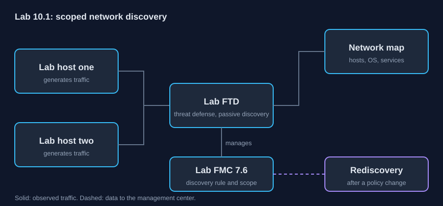

# Lab: Scope network discovery deliberately

Video: [Cisco FMC & FTD: Network Discovery: What Can You Learn About Your Network?](https://youtu.be/btv8VH0l5a4)
Reference: Cisco Secure Firewall Management Center Device Configuration Guide 7.6,
chapters 77 and 80 (PDF pages 2653-2660, 2717-2718). Check the guide for your exact version.

> **Use a lab FMC/FTD or a virtual lab, never production.**

## Goal

Build an inventory from traffic you already see. You add one lab subnet as a monitored network, exclude a noisy port, deploy, find two hosts in the network map with OS, services and applications, then change the scope and observe rediscovery.

## Background

- A device nobody knew about can bring down a critical server or open a path for an attacker. Spreadsheets of addresses are out of date the day they are saved. Network discovery builds an inventory from the traffic your managed devices already see.
- The management center collects and correlates discovery data from managed devices to build the network map: hosts, servers, applications and optionally users. It works passively from observed traffic, so it does not disturb fragile or legacy endpoints.
- Examples of what is collected: MAC address (hardware identity of local hosts), operating system (passive fingerprint), TTL and hops (how many routed hops away), server identity (services offered) and application data (client and web applications in use).
- Observation coverage is set with discovery rules and should be deliberate: monitored networks (the subnets you are responsible for, not every network you can see), port exclusions (high-volume, well-understood traffic such as a nightly backup that adds load without new information) and zones (limit discovery to the interfaces you are responsible for).
- Rediscovery: when you deploy a changed network discovery policy, the system deletes and rediscovers MAC address, TTL and hop information for hosts in your monitored networks, and affected managed devices discard discovery data they have not yet sent. Plan such changes for a maintenance window and check the inventory afterwards.

## Prerequisites

- A lab management center and threat defense (never production).
- Two lab hosts that generate traffic through the firewall.

Values you will use (keep them as placeholders in anything you share, never commit real values):

| Placeholder | What it is |
|---|---|
| `<LAB_SUBNET>` | the lab subnet to monitor |
| `<NOISY_PORT>` | a noisy lab service port to exclude |
| `<HOST_ONE>` | the first lab host |
| `<HOST_TWO>` | the second lab host |
| `<INSIDE_ZONE>` | the zone to limit discovery to |

## Steps

### Part 1: scope

1. Open the network discovery policy and review the existing rule or rules.
2. Add `<LAB_SUBNET>` as a monitored network, limit the rule to `<INSIDE_ZONE>` and set it to discover hosts and applications.
3. Add a port exclusion for `<NOISY_PORT>`.

### Part 2: observe

4. Deploy and generate traffic from `<HOST_ONE>` and `<HOST_TWO>`.
5. Find both hosts in the network map and note OS, services and applications.

### Part 3: rediscovery

6. Change the monitored networks, redeploy and observe that MAC, TTL and hop data is rediscovered.

## Check your work

Use [checklist.md](checklist.md). If something does not work, start with
[troubleshooting.md](troubleshooting.md).

## Clean up

Restore the original discovery rule and deploy again.

---
*Always confirm behavior against the guide for your exact FMC/FTD version. Independent training by Hexward Labs; not affiliated with or endorsed by Cisco Systems.*
