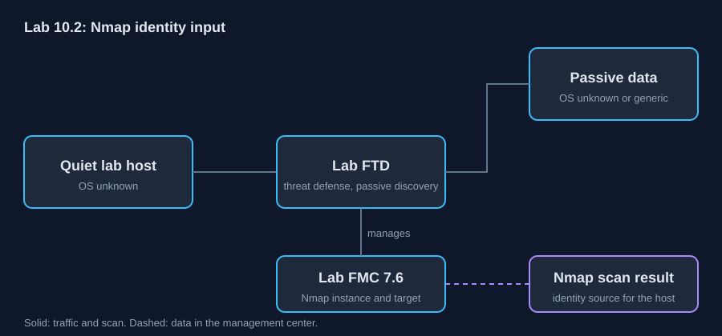

# Lab: Identify a quiet host with an Nmap scan

Video: [Cisco FMC & FTD: Host Identity, Fingerprinting, and Nmap Input](https://youtu.be/XsGQmNTMsUA)
Reference: Cisco Secure Firewall Management Center Device Configuration Guide 7.6,
chapter 78 (PDF pages 2661-2696). Check the guide for your exact version.

> **Use a lab FMC/FTD or a virtual lab, never production.**

## Goal

Resolve an unknown host identity safely. You find a lab host whose OS is unknown, add an Nmap scan instance and a single-host scan target, run an on-demand scan, and compare the host profile and its identity source before and after.

## Background

- Many policies depend on knowing what a host really is. If the management center cannot identify a device's operating system it cannot recommend the right intrusion rules or give an accurate network map. Quiet or unusual devices often stay unknown from passive data alone, so you need extra sources.
- Sources: passive detection (managed devices observe traffic and fingerprint hosts without touching them); NetFlow data (adds hosts whose traffic does not cross a managed device); third-party mappings or host input (identity data imported from other tools); custom fingerprints (for unusual client or server systems); and an Nmap scan (an active scan of chosen targets to confirm identity).
- Data flow: managed devices send discovery events to the management center, which uses that data in policies and deploys policy back to the devices.
- Nmap workflow in the management center: add an Nmap scan instance (the scanner and its settings), add an Nmap scan target (the hosts or subnets to scan), then run an on-demand scan and review the results.
- Identity sources and conflicts: by default identity data added by a scanner or third-party application overrides what the system detects passively; among several such sources the one you rank highest is used, and user input overrides all of them. When active and passive data disagree, the identity conflict settings in the network discovery policy decide.
- Common mistakes: creating a custom fingerprint but not activating it, editing an inactive fingerprint and expecting it to be used, wrong third-party mappings, and an Nmap instance with no scan target.

## Prerequisites

- A lab management center and threat defense with passive discovery working (never production).
- A lab host you own with an unknown or generic OS in the network map.

Values you will use (keep them as placeholders in anything you share, never commit real values):

| Placeholder | What it is |
|---|---|
| `<QUIET_HOST>` | the lab host with an unknown OS |
| `<NMAP_INSTANCE>` | name of the Nmap scan instance |
| `<NMAP_TARGET>` | name of the Nmap scan target |

## Steps

### Part 1: find the host

1. Find `<QUIET_HOST>` in the network map and note that its OS is unknown or generic.

### Part 2: scan

2. Add Nmap scan instance `<NMAP_INSTANCE>` with conservative settings.
3. Add scan target `<NMAP_TARGET>` for that single host only.
4. Run an on-demand scan and wait for the result.

### Part 3: compare

5. Open the host profile and compare the OS before and after the scan; note which source provided it.
6. Optionally review the identity source priority settings and note the order.

## Check your work

Use [checklist.md](checklist.md). If something does not work, start with
[troubleshooting.md](troubleshooting.md).

## Clean up

Remove the lab scan instance and target if you no longer need them.

---
*Always confirm behavior against the guide for your exact FMC/FTD version. Independent training by Hexward Labs; not affiliated with or endorsed by Cisco Systems.*
