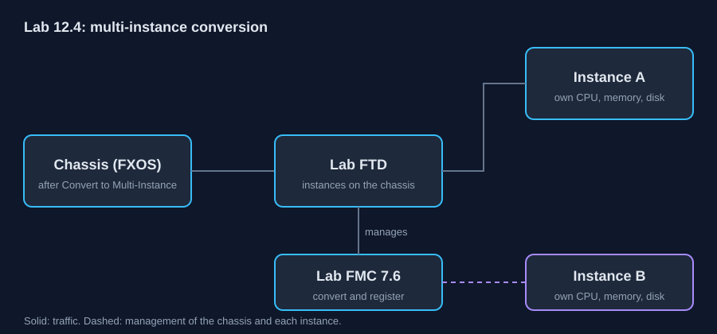

# Lab: Plan a multi-instance conversion

Video: [Cisco FMC & FTD: Multi-Instance Mode on Secure Firewall 3100/4200](https://youtu.be/wNpblSl3WVo)
Reference: Cisco Secure Firewall Management Center Device Configuration Guide 7.6,
chapter 9 (PDF pages 437-472). Check the guide for your exact version.

> **Use a lab FMC/FTD or a virtual lab, never production.**

## Goal

Convert a lab Secure Firewall 3100 or 4200 to multi-instance mode without surprises. You verify the model and version, check the manager access method, record what you must rebuild, run the conversion, confirm the deploy mode at the FXOS CLI and create two instances.

## Background

- By default the device runs one native threat defense that uses all resources. In multi-instance mode the chassis runs FXOS and hosts several container instances, each with dedicated CPU, memory and disk and its own threat defense version. Instances behave as independent devices and can be upgraded or restarted separately.
- Documented support: Secure Firewall 3100 from 7.4.1 (not the 3105) and Secure Firewall 4200 from 7.6.0. The device must be added to the management center as a standalone device before conversion.
- Not compatible with conversion: a data interface used for manager access, DHCP on the Management interface (use a static IP) and zero-touch provisioning.
- The conversion is started from Devices > Device Management > More > Convert to Multi-Instance (there is also a bulk action). The device restarts, all configuration is erased except the Management network settings and the admin password, and the hostname becomes a generic firepower-model name. Plan roughly 15 minutes.
- Instance interfaces: the dedicated Management interface is shared by the chassis and every instance with a unique IP each. Data interfaces are assigned to one instance (VLAN subinterfaces can split a port or port channel). Data-sharing interfaces can be shared by several instances over the backplane, each with its own IP, but not for bridge groups, inline sets, passive interfaces or failover links.

## Prerequisites

- A lab Secure Firewall 3100 or 4200 on a supported version, registered to a lab management center as a standalone device (never production).
- Manager access over the dedicated Management interface with a static IP, not DHCP, not a data interface and not onboarded by zero-touch provisioning.
- A written list of the configuration you will have to rebuild after the conversion.

Values you will use (keep them as placeholders in anything you share, never commit real values):

| Placeholder | What it is |
|---|---|
| `<CHASSIS_MGMT_IP>` | static management IP kept by the chassis |
| `<INSTANCE_A_MGMT_IP>` | management IP for the first instance |
| `<INSTANCE_B_MGMT_IP>` | management IP for the second instance |
| `<DATA_INTERFACE_A>` | data interface for the first instance |
| `<DATA_INTERFACE_B>` | data interface for the second instance |
| `<SHARED_INTERFACE>` | data-sharing interface used by both instances |

## Steps

### Part 1: Check before converting

1. Confirm the model and software version are supported and that the device is not a 3105.
2. Confirm the device is registered as standalone and manager access uses the Management interface with the static address `<CHASSIS_MGMT_IP>`.
3. Confirm it was not onboarded by zero-touch provisioning and does not use a data interface for manager access.
4. Record the configuration that will be erased so you can rebuild it.

### Part 2: Convert

5. Open Devices > Device Management, choose More on the device and select Convert to Multi-Instance.
6. Wait for the restart and for the device to come back with a generic firepower-model hostname.
7. At the FXOS CLI run `show system detail` and note the deploy mode (container mode after conversion, native before).

### Part 3: Create two instances

8. Create two instances with unique management IPs `<INSTANCE_A_MGMT_IP>` and `<INSTANCE_B_MGMT_IP>`.
9. Assign `<DATA_INTERFACE_A>` to the first instance and `<DATA_INTERFACE_B>` to the second.
10. Assign `<SHARED_INTERFACE>` to both instances as a data-sharing interface only where the documentation allows it.
11. Register each instance to the management center and confirm each appears as its own device.

## Where this lab follows the documentation

Instance management does not run over a port channel. All instances share the chassis's dedicated Management interface, each with its own management IP address; port channels are examples of data interfaces. For the way back to native mode, the documentation describes an exact FXOS CLI procedure that erases all configuration and bootable images and restarts the device, so follow the guide for your version instead of a command remembered from the video.

## Check your work

Use [checklist.md](checklist.md). If something does not work, start with
[troubleshooting.md](troubleshooting.md).

## Clean up

To return the lab device to native mode, follow the FXOS CLI procedure in the configuration guide for your version. It erases all configuration and bootable images and restarts the device, so run it only on lab equipment.

---
*Always confirm behavior against the guide for your exact FMC/FTD version. Independent training by Hexward Labs; not affiliated with or endorsed by Cisco Systems.*
