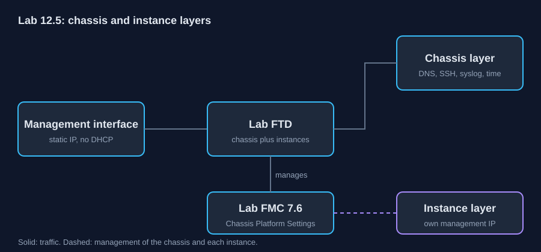

# Lab: Separate chassis and instance management

Video: [Cisco FMC & FTD: Operating Multi-Instance Devices](https://youtu.be/9dWjXOd68R0)
Reference: Cisco Secure Firewall Management Center Device Configuration Guide 7.6,
chapter 9 (PDF pages 473-502). Check the guide for your exact version.

> **Use a lab FMC/FTD or a virtual lab, never production.**

## Goal

Keep the two layers of a multi-instance device apart. You verify the chassis rules, apply a Chassis Platform Settings policy, create a resource profile, give every instance its own management IP and VLAN subinterface, and confirm each instance is a separate device in the management center.

## Background

- After conversion you manage the chassis and the instances that run on it. Many outages come from mixing them up, for example reusing the chassis management IP for an instance or relying on DHCP or a data interface for chassis management.
- Hard rules for the chassis: supported on the Secure Firewall 3100 and 4200 but not the 3105; chassis management uses only the dedicated Management interface (never a data interface); no DHCP on the Management interface, use a static IPv4 or IPv6 address.
- The conversion keeps only the Management network settings and the admin password. Everything else is erased and the hostname becomes a generic firepower-model name.
- Chassis layer: the chassis has its own management IP and its own connection to the management center. Chassis-wide settings come from a Chassis Platform Settings policy (Devices > Platform Settings > New Policy > Chassis Platform Settings): DNS, SSH and the SSH access list, syslog, time synchronization and time zones.
- Resources and interfaces: resource profiles set the CPU cores each instance gets and memory scales with the cores. You assign data interfaces to instances and can create VLAN subinterfaces on the chassis to split a physical port between instances.
- Instance layer: each instance is an independent threat defense with its own management IP on the shared Management interface and its own registration to the management center. You configure it like any other threat defense device.

## Prerequisites

- A lab Secure Firewall 3100 or 4200 already converted to multi-instance mode (see the previous lab) and a lab management center (never production).
- A static IP plan with one address for the chassis and a different address for each instance.

Values you will use (keep them as placeholders in anything you share, never commit real values):

| Placeholder | What it is |
|---|---|
| `<CHASSIS_MGMT_IP>` | static management IP of the chassis |
| `<INSTANCE_A_MGMT_IP>` | management IP of the first instance |
| `<INSTANCE_B_MGMT_IP>` | management IP of the second instance |
| `<DNS_SERVER>` | lab DNS server for the chassis policy |
| `<NTP_SERVER>` | lab time source for the chassis policy |
| `<SYSLOG_SERVER>` | lab syslog receiver |
| `<RESOURCE_PROFILE>` | name of the profile that sets CPU cores |
| `<VLAN_ID_A>` | VLAN for the first instance's subinterface |
| `<VLAN_ID_B>` | VLAN for the second instance's subinterface |

## Steps

### Part 1: Confirm the chassis rules

1. Confirm the chassis Management interface uses the static address `<CHASSIS_MGMT_IP>` and not DHCP.
2. At the FXOS CLI run `show system detail` and confirm container (multi-instance) mode and the generic firepower-model hostname.

### Part 2: Chassis settings

3. Create a Chassis Platform Settings policy under Devices > Platform Settings with `<DNS_SERVER>`, `<NTP_SERVER>` and `<SYSLOG_SERVER>`, then assign it to the chassis.

### Part 3: Instances

4. Create the resource profile `<RESOURCE_PROFILE>` with the CPU cores each instance needs.
5. Create two instances with the unique management IPs `<INSTANCE_A_MGMT_IP>` and `<INSTANCE_B_MGMT_IP>` on the Management network.
6. Create one VLAN subinterface per instance on the chassis (`<VLAN_ID_A>` and `<VLAN_ID_B>`) and assign each to its instance.
7. Register both instances and confirm each appears as a separate device in the management center.

## Check your work

Use [checklist.md](checklist.md). If something does not work, start with
[troubleshooting.md](troubleshooting.md).

## Clean up

Remove the instances and the lab policy when finished. Returning the device to native mode uses the FXOS CLI procedure in the configuration guide for your version and erases all configuration, so use lab equipment only.

---
*Always confirm behavior against the guide for your exact FMC/FTD version. Independent training by Hexward Labs; not affiliated with or endorsed by Cisco Systems.*
