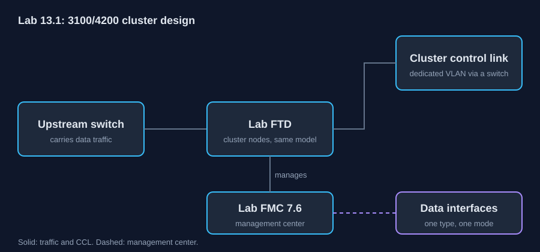

# Lab: Design review before you form a 3100/4200 cluster

Video: [Cisco FMC & FTD: Secure Firewall 3100/4200 Clustering: Design and Prerequisites](https://youtu.be/1cW2ajxX1ZQ)
Reference: Cisco Secure Firewall Management Center Device Configuration Guide 7.6,
chapter 11 (PDF pages 537-543 and 586-604). Check the guide for your exact version.

> **Use a lab FMC/FTD or a virtual lab, never production.**

## Goal

Catch the design mistakes that stop a cluster from forming. You review each node against the documented requirements, draw the cluster control link (CCL), choose the data interface type and confirm nothing is pending in the management center.

## Background

- Clustering makes several threat defense nodes act as one logical device: one point of management, combined throughput and redundancy. A cluster that will not form is usually a design problem, not a typo.
- The CCL is an isolated, dedicated network for state sharing, health checks and forwarding between nodes. If the CCL is unhealthy, the cluster is unhealthy.
- On the Secure Firewall 3100/4200 (7.6): up to 16 nodes; same model, interfaces, network modules and slots on every node; same software version (except during a hitless upgrade); same firewall mode; same management center domain and group; no deployment pending or in progress.
- Data interfaces are Spanned EtherChannel (recommended) or Individual interfaces (routed mode only). All data interfaces in the cluster must be one type.
- The CCL MTU is set automatically to 100 bytes more than the highest data interface MTU (1600 by default). Your CCL switch ports must carry that size, and the CCL goes through a switch, not a back-to-back cable (testing is the only exception).
- Point every node to the same reliable NTP source. By default PAT port blocks are reserved for a 16-node cluster; the guide describes a FlexConfig command, cluster-member-limit, for smaller clusters. Confirm it for your version before using it.

## Prerequisites

- A lab management center and two or more lab threat defense nodes (or a paper design if you have no hardware yet).
- Access to the lab switch that will carry the CCL.

Values you will use (keep them as placeholders in anything you share, never commit real values):

| Placeholder | What it is |
|---|---|
| `<NODE_1>` | first lab node |
| `<NODE_2>` | second lab node |
| `<NTP_SERVER>` | the NTP source every node uses |
| `<CCL_VLAN>` | dedicated switch VLAN for the CCL |
| `<DATA_MTU>` | the highest data interface MTU you plan to use |

## Steps

### Part 1: match the nodes

1. For `<NODE_1>` and `<NODE_2>` write down the model, network modules, software version and firewall mode. All four must match.
2. Confirm both nodes use `<NTP_SERVER>`.
3. Confirm no deployment is pending or in progress for either node in the management center.

### Part 2: design the CCL

4. Draw the CCL: a dedicated switch VLAN `<CCL_VLAN>`, no direct node-to-node cable.
5. Calculate the CCL MTU as `<DATA_MTU>` plus 100 (1600 with the default data MTU) and check that every CCL switch port carries it.

### Part 3: choose the data mode

6. Choose Spanned EtherChannel or Individual interfaces (routed mode only) and write down why. Do not mix them.
7. Decide the number of nodes and note whether PAT port reservation needs tuning.

### Part 4: after the cluster forms

8. Run `show cluster info` and confirm every node and its role.
9. Run `show cluster history` and confirm there are no MTU-check failures.

## Where this lab follows the documentation

The video says the 154-byte CCL MTU rule applies here and that multi-chassis clusters need EtherChannel data interfaces. The 154-byte rule is for threat defense virtual clusters; on the 3100/4200 the CCL MTU is automatic (100 bytes above the highest data MTU). The EtherChannel-only rule is a Firepower 4100/9300 rule; the 3100/4200 supports Spanned EtherChannel or Individual interfaces, one type only. The guide describes the join-time MTU check as a notification, not a rejection. Data interfaces are configured after the cluster exists. This lab follows the documentation.

## Check your work

Use [checklist.md](checklist.md). If something does not work, start with
[troubleshooting.md](troubleshooting.md).

## Clean up

This lab is a design review and changes nothing. If you formed a lab cluster to test it, break the cluster in the management center and remove the lab CCL VLAN.

---
*Always confirm behavior against the guide for your exact FMC/FTD version. Independent training by Hexward Labs; not affiliated with or endorsed by Cisco Systems.*
