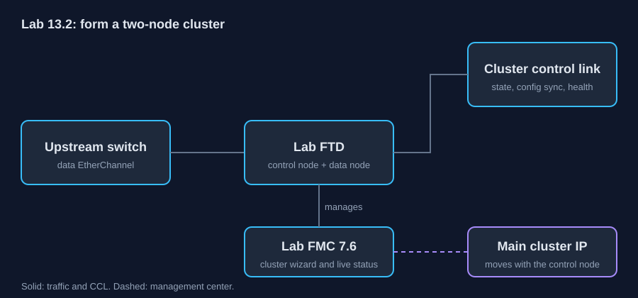

# Lab: Form and monitor a two-node 3100/4200 cluster

Video: [Cisco FMC & FTD: 3100/4200 Clustering: Configuration and Operations](https://youtu.be/SvBu7cukoSo)
Reference: Cisco Secure Firewall Management Center Device Configuration Guide 7.6,
chapter 11 (PDF pages 544-585). Check the guide for your exact version.

> **Use a lab FMC/FTD or a virtual lab, never production.**

## Goal

Form a small cluster in the right order and learn where to look when something is off. You register two nodes as standalone devices, build the cluster, add a data EtherChannel, read the status views and reload the control node to watch the main cluster IP move.

## Background

- The control node owns the main cluster IP address and pushes configuration to the data nodes. All nodes pass and inspect traffic. If the control node fails, a new control node is elected and the main cluster IP moves with it, so management access continues.
- The CCL is an isolated network for state sharing, configuration sync and health checks. In 7.6 the 3100 and 4200 support up to 16 nodes.
- Data interface modes: Spanned EtherChannel (recommended), or Individual interfaces (routed mode only). Mixing the two is not allowed.
- Build order in the management center: 1) add each node as a standalone device in the same domain and group; 2) enable the CCL interface on the intended control node and deploy; 3) Devices > Device Management > Add > Cluster, with cluster name, cluster key, control node, CCL network and interface, and node priorities, then choose the cluster mode; 4) configure data interfaces after the cluster has formed.

## Prerequisites

- Two identical lab threat defense devices passing the design review in lab 13.1.
- A lab management center and a switch for the CCL and the data EtherChannel.

Values you will use (keep them as placeholders in anything you share, never commit real values):

| Placeholder | What it is |
|---|---|
| `<CLUSTER_NAME>` | name of the lab cluster |
| `<CLUSTER_KEY>` | shared cluster key (secret; never commit) |
| `<CCL_NETWORK>` | network used for the CCL |
| `<NODE_1>` | intended control node |
| `<NODE_2>` | second node |
| `<MAIN_CLUSTER_IP>` | main cluster IP address |

## Steps

### Part 1: prepare

1. Register `<NODE_1>` and `<NODE_2>` as standalone devices in the same domain and group.
2. On `<NODE_1>`, enable the CCL interface and deploy.

### Part 2: form the cluster

3. Open Devices > Device Management > Add > Cluster. Enter `<CLUSTER_NAME>` and `<CLUSTER_KEY>`, select `<NODE_1>` as control node, set `<CCL_NETWORK>` and the CCL interface, and set node priorities.
4. Choose Spanned EtherChannel mode.
5. After the cluster forms, build one data EtherChannel and deploy.

### Part 3: observe

6. Open Cluster Live Status and confirm all nodes are in sync.
7. Open the cluster health monitor dashboard and note CPU and connection metrics per node.
8. On a node run `show cluster info` and `show cluster info health`.

### Part 4: fail the control node

9. Reload the control node and confirm the other node takes over the control role and that `<MAIN_CLUSTER_IP>` is reachable on the new control node.

## Check your work

Use [checklist.md](checklist.md). If something does not work, start with
[troubleshooting.md](troubleshooting.md).

## Clean up

Break the lab cluster in the management center (or delete it), remove the lab data EtherChannel and CCL configuration, and deploy again.

---
*Always confirm behavior against the guide for your exact FMC/FTD version. Independent training by Hexward Labs; not affiliated with or endorsed by Cisco Systems.*
