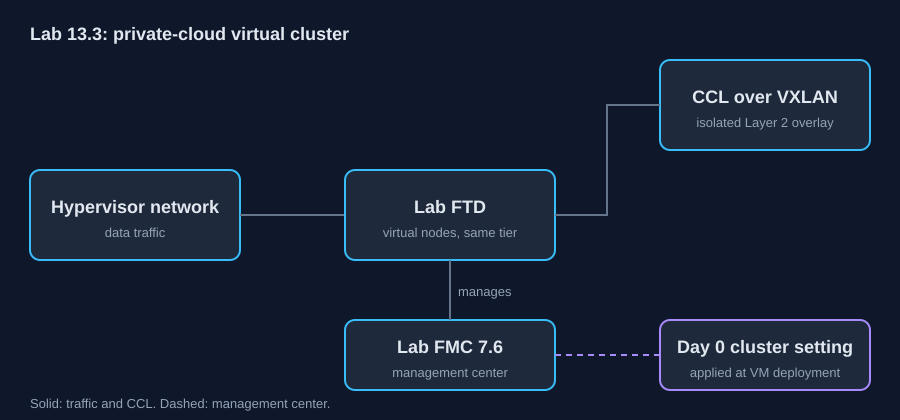

# Lab: Build a two-node threat defense virtual cluster on VMware or KVM

Video: [Cisco Secure Firewall: FTD Virtual Clustering in Private Clouds](https://youtu.be/PAU_8SGoBR4)
Reference: Cisco Secure Firewall Management Center Device Configuration Guide 7.6,
chapter 12 (PDF pages 605-658). Check the guide for your exact version.

> **Use a lab FMC/FTD or a virtual lab, never production.**

## Goal

Get the order and the shared requirements right for a private-cloud virtual cluster. You deploy two nodes of one tier with the cluster setting in Day 0, put the CCL on an isolated VXLAN network, register both nodes and check failover.

## Background

- In a private cloud the CCL uses VXLAN interfaces, a Layer 2 overlay on the Layer 3 network, so nodes can exchange broadcast and multicast cluster traffic. VXLAN is supported only for the CCL, not for data interfaces.
- Documented limits (7.6): up to 16 nodes in a 4x4 layout; FTDv5 to FTDv100 supported but all nodes on the same performance tier; same software version (except during a hitless upgrade); CCL is IPv4 only with an MTU 154 bytes above the highest data MTU (1654 by default); data interfaces are Individual interfaces in routed mode, no subinterfaces; management interface only; site-to-site VPN on the control node only; on KVM, CPU pinning for all VMs on the host.
- The Day 0 configuration is applied when you deploy each virtual machine. That is where you set DeploymentType to Cluster so jumbo-frame reservation for the CCL is on from the start. Then register the nodes in the same domain and group.
- Decryption state is not synchronized: if the owner of a decrypted TLS/SSL connection fails, that connection resets and the user reconnects. Before a topology change such as adding or removing an EtherChannel, disable the cluster health check and interface monitoring for the affected interfaces, make the change, wait for sync, then re-enable them.

## Prerequisites

- A lab VMware or KVM host with enough resources for two virtual nodes of one tier.
- A lab management center in the same domain and group you will use for both nodes.

Values you will use (keep them as placeholders in anything you share, never commit real values):

| Placeholder | What it is |
|---|---|
| `<TIER>` | the performance tier used by both nodes |
| `<VERSION>` | the same software version for both nodes |
| `<CCL_NETWORK>` | isolated network for the CCL |
| `<CLUSTER_NAME>` | name of the lab cluster |
| `<CLUSTER_KEY>` | shared cluster key (secret; never commit) |
| `<NODE_1>` | first virtual node |
| `<NODE_2>` | second virtual node |

## Steps

### Part 1: deploy the nodes

1. Deploy `<NODE_1>` and `<NODE_2>` with the same `<TIER>` and `<VERSION>`. Include the Day 0 setting for a cluster deployment (DeploymentType: Cluster) in each Day 0 configuration.
2. Create an isolated network `<CCL_NETWORK>` for the CCL and use IPv4 addressing.
3. On KVM, confirm CPU pinning is set for the VMs.

### Part 2: register and form

4. Register both nodes in the same domain and group and confirm no deployment is pending.
5. Form `<CLUSTER_NAME>` as described in the guide for your version, using Individual data interfaces. Use `<CLUSTER_KEY>` when asked.

### Part 3: verify and fail over

6. Run `show cluster info` and confirm the cluster state is On with all nodes listed.
7. Reload the control node and confirm a data node takes over the control role.

## Where this lab follows the documentation

The video lists the Day 0 configuration as the last build step, after placing the nodes in the management center. In practice the Day 0 configuration is applied when you deploy each virtual machine, which is where you set DeploymentType to Cluster so jumbo-frame reservation for the CCL is enabled from the start. You then register the nodes. This lab uses that order.

## Check your work

Use [checklist.md](checklist.md). If something does not work, start with
[troubleshooting.md](troubleshooting.md).

## Clean up

Delete the lab cluster in the management center, then remove the virtual nodes and the lab CCL network from the hypervisor.

---
*Always confirm behavior against the guide for your exact FMC/FTD version. Independent training by Hexward Labs; not affiliated with or endorsed by Cisco Systems.*
