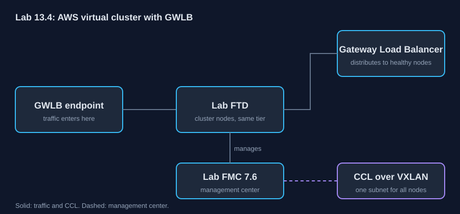

# Lab: Review and deploy an AWS threat defense virtual cluster

Video: [Cisco Secure Firewall: FTD Virtual Clustering on AWS](https://youtu.be/5rM27fVZSSM)
Reference: Cisco Secure Firewall Management Center Device Configuration Guide 7.6,
chapter 13 (PDF pages 659-689 and 716-750). Check the guide for your exact version.

> **Use a lab FMC/FTD or a virtual lab, never production, and an AWS lab account.**

## Goal

Make an AWS cluster survive a node failure. You check the supported tier and licensing order, prepare the template inputs, watch the cluster status, and set the Gateway Load Balancer (GWLB) target failover behavior deliberately.

## Background

- Architecture: traffic enters through a GWLB endpoint, goes to the GWLB, and the GWLB distributes it to healthy cluster nodes. The nodes' data interfaces are registered in a GWLB target group.
- The CCL uses VXLAN interfaces; all CCL interfaces must be in the same subnet. Up to 16 nodes. FTDv20, FTDv30, FTDv50 and FTDv100 are supported; FTDv5 and FTDv10 do not support AWS GWLB. All nodes use the same tier. Jumbo-frame reservation for the CCL is enabled in the Day 0 configuration. Management interface only.
- The deployment uses CloudFormation templates from Cisco's GitHub repository. In Configuration.json keep fmcIpforDeviceReg as DONTRESOLVE. The Lambda layer cluster_layer.zip is built on Amazon Linux with Python 3.9 (an EC2 instance with the Amazon Linux 2023 AMI, or AWS CloudShell).
- License the management center before you register the cluster. If you add the cluster in evaluation mode and license later, all data units leave and rejoin, which can disrupt traffic.
- GWLB target failover: no_rebalance keeps existing flows on the failed target while new flows go to healthy targets; rebalance redistributes existing flows and needs threat defense 7.4.1 or later. The Cisco template parameter TargetFailover defaults to rebalance, but the AWS console default is no_rebalance, so check it.

## Prerequisites

- An AWS lab account with permission to run the Cisco CloudFormation templates.
- A licensed lab management center reachable from the VPC.

Values you will use (keep them as placeholders in anything you share, never commit real values):

| Placeholder | What it is |
|---|---|
| `<AWS_REGION>` | the lab region |
| `<TIER>` | FTDv20 or higher, the same for all nodes |
| `<STACK_NAME>` | name of the lab CloudFormation stack |
| `<TARGET_GROUP>` | the GWLB target group |
| `<FMC_ADDRESS>` | management center address (not resolved by name in the template) |

## Steps

### Part 1: review

1. Pick one supported tier `<TIER>` (FTDv20 or higher) for every node.
2. Confirm the management center is licensed (not in evaluation mode).

### Part 2: prepare the template

3. Download the CloudFormation templates and Configuration.json from Cisco's repository. Keep fmcIpforDeviceReg as DONTRESOLVE.
4. Build cluster_layer.zip on Amazon Linux with Python 3.9.

### Part 3: deploy and watch

5. Deploy the stack `<STACK_NAME>` in `<AWS_REGION>`.
6. Watch the Cluster Status dialog until every node is In Sync. Use Reconcile All if a node stays unregistered.
7. On a node run `show cluster info`.

### Part 4: failover behavior

8. Check the target failover attributes on `<TARGET_GROUP>` and set them to rebalance (threat defense 7.4.1 or later). Note the difference from no_rebalance.

## Where this lab follows the documentation

The video describes the node status sequence as Joining cluster, Available for Registration, In Sync. The documented states include Joining cluster, Pending Registration and In Sync; if a node does not register, use Reconcile All. The video also says that with no_rebalance all traffic follows the failed target; the guide says existing flows keep going to the failed target while new flows go to healthy targets. This lab follows the documentation.

## Check your work

Use [checklist.md](checklist.md). If something does not work, start with
[troubleshooting.md](troubleshooting.md).

## Clean up

Delete the lab CloudFormation stack and any lab Lambda layer or EC2 helper instance, and remove the lab cluster from the management center. Check your AWS bill for leftover resources.

---
*Always confirm behavior against the guide for your exact FMC/FTD version. Independent training by Hexward Labs; not affiliated with or endorsed by Cisco Systems.*
