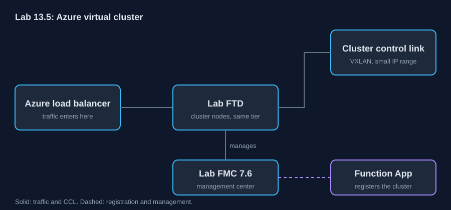

# Lab: Plan and deploy an Azure threat defense virtual cluster

Video: [Cisco Secure Firewall: FTD Virtual Clustering on Azure](https://youtu.be/GdeFtGYq9sM)
Reference: Cisco Secure Firewall Management Center Device Configuration Guide 7.6,
chapter 13 (PDF pages 659-665, 690-707 and 716-750). Check the guide for your exact version.

> **Use a lab FMC/FTD or a virtual lab, never production, and an Azure lab subscription.**

## Goal

Avoid the registration failures that come from requirements missed before deployment. You verify tier, Day 0 setting, VPN placement and licensing, size the CCL range, deploy the Cisco template and upload the function zip.

## Background

- Shared requirements for all nodes (7.6): up to 16 nodes; same model, interfaces and software version (hitless upgrade is supported); same domain and group; same performance tier; jumbo-frame reservation for the CCL in the Day 0 configuration; site-to-site VPN only on the control node; management interface only.
- FTDv5 and FTDv10 do not support the Azure Gateway Load Balancer (GWLB), so with a GWLB design you need FTDv20 or higher.
- When you enter the CCL IP range, specify only as many addresses as you need (up to 16). A larger range can affect performance.
- Manual deployment workflow: 1) deploy the Cisco custom Azure template (infrastructure and networking); 2) fill in the instance details including the CCL IP range; 3) in the Function App open Deployment Center > FTPS credentials and create user-scope credentials; 4) upload the cluster function zip to the Function App with a curl POST using those credentials (zip deploy, a few minutes); 5) the Function App calls the management center APIs over the Management interface and registers the cluster.
- License the management center first. If you add the cluster in evaluation mode and license later, all data units leave and rejoin, which can disrupt traffic.

## Prerequisites

- An Azure lab subscription with permission to deploy the Cisco template.
- A licensed lab management center reachable over the Management interface.

Values you will use (keep them as placeholders in anything you share, never commit real values):

| Placeholder | What it is |
|---|---|
| `<TIER>` | FTDv20 or higher if you use the Azure GWLB |
| `<CCL_IP_RANGE>` | the smallest CCL range that covers your node count |
| `<RESOURCE_GROUP>` | lab resource group |
| `<FUNCTION_APP>` | the Function App created by the template |
| `<FTPS_USER>` | user-scope FTPS user name (secret; never commit) |
| `<FTPS_PASSWORD>` | user-scope FTPS password (secret; never commit) |

## Steps

### Part 1: plan

1. Pick one tier `<TIER>` for all nodes and prepare the Day 0 configuration with jumbo-frame reservation for the CCL.
2. Size `<CCL_IP_RANGE>` to the node count you need.
3. License the management center.

### Part 2: deploy

4. Deploy the Cisco custom Azure template into `<RESOURCE_GROUP>` and fill in the instance details.
5. In `<FUNCTION_APP>` open Deployment Center > FTPS credentials and create user-scope credentials.
6. Upload the cluster function zip to the Function App with a curl POST using those credentials, as in the guide.

### Part 3: verify

7. Run `show cluster info` on a node and check the cluster in the management center.
8. If registration looks stuck, read the logs in the storage account's outqueue to see what the Function App did.

## Where this lab follows the documentation

The video says FTDv5 and FTDv10 are supported for Azure clustering without a caveat. They are listed, but they do not support the Azure Gateway Load Balancer, so a GWLB design needs FTDv20 or higher. The video also names a resource-action success queue; the guide points to the logs in the storage account's outqueue. This lab follows the documentation.

## Check your work

Use [checklist.md](checklist.md). If something does not work, start with
[troubleshooting.md](troubleshooting.md).

## Clean up

Delete the lab resource group (this removes the nodes, Function App and storage account) and remove the lab cluster from the management center.

---
*Always confirm behavior against the guide for your exact FMC/FTD version. Independent training by Hexward Labs; not affiliated with or endorsed by Cisco Systems.*
