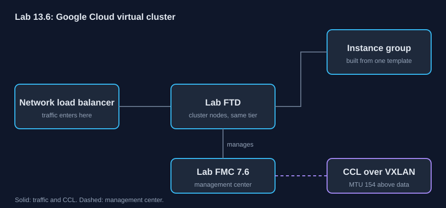

# Lab: Plan a Google Cloud threat defense virtual cluster

Video: [Cisco Secure Firewall: FTD Virtual Clustering on Google Cloud](https://youtu.be/-lbVosdSnwY)
Reference: Cisco Secure Firewall Management Center Device Configuration Guide 7.6,
chapter 13 (PDF pages 659-665 and 708-750). Check the guide for your exact version.

> **Use a lab FMC/FTD or a virtual lab, never production, and a Google Cloud lab project.**

## Goal

Know exactly what to build, and in what order, before you touch the console. You choose one tier and machine type, plan the CCL MTU, prepare the Day 0 script and list the instance template, instance group, load balancers and health-check firewall rules.

## Background

- Nodes act as one logical device and exchange state over the CCL, which uses VXLAN interfaces on the cloud network.
- Requirements (7.6): up to 16 nodes; same model, tier and software version; same domain and group; routed mode only; management interface only; site-to-site VPN only on the control node; license the management center before adding the cluster.
- For GCP the guide sets the CCL MTU 154 bytes higher than the data interfaces (for example 1554 for the CCL with 1400 on data). Build the Day 0 script from the sample in the guide for your version.
- Workflow: start on your workstation with the Day 0 script, build the infrastructure in Google Cloud, then register and verify in the management center. Manual node deployment: 1) create an instance template that uses the Day 0 script; 2) create the instance group; 3) create the network load balancers; 4) create firewall rules that allow health-check traffic; 5) add the control node to the management center.
- If the management center is in evaluation mode when you add the cluster and you license it later, all data units leave and rejoin, which can disrupt traffic.

## Prerequisites

- A Google Cloud lab project with permission to create instance templates, instance groups and load balancers.
- A licensed lab management center reachable from the project network.

Values you will use (keep them as placeholders in anything you share, never commit real values):

| Placeholder | What it is |
|---|---|
| `<GCP_PROJECT>` | lab project |
| `<MACHINE_TYPE>` | machine type allowed for your tier |
| `<DATA_MTU>` | data interface MTU (for example 1400) |
| `<CCL_MTU>` | the data MTU plus 154 |
| `<INSTANCE_GROUP>` | the lab instance group |

## Steps

### Part 1: plan

1. Choose one tier and `<MACHINE_TYPE>` for all nodes and confirm it is allowed for your design.
2. Plan `<DATA_MTU>` and `<CCL_MTU>` (data plus 154).
3. Prepare the Day 0 script from the guide's sample for your version.

### Part 2: build in Google Cloud

4. Create the instance template (uses the Day 0 script), then the instance group `<INSTANCE_GROUP>` in `<GCP_PROJECT>`.
5. Create the network load balancers and the firewall rules that allow health-check traffic.

### Part 3: register and verify

6. Confirm the management center is licensed, then add the control node.
7. Run `show cluster info` on a node and confirm all nodes and one control node.
8. Confirm the load balancer sees healthy backends.

## Where this lab follows the documentation

The video describes a jumbo-frame reservation step in the Day 0 script. The GCP section of the guide does not; it sets the CCL MTU 154 bytes above the data interfaces. The video also says an end user never sees a dropped connection; most connection state is shared, but decryption state is not, so decrypted TLS connections owned by a failed node are reset. The video's reasons for why data-interface management and VPN on data nodes fail are its own explanation; the guide simply says neither is supported. This lab follows the documentation.

## Check your work

Use [checklist.md](checklist.md). If something does not work, start with
[troubleshooting.md](troubleshooting.md).

## Clean up

Delete the lab instance group, instance template, load balancers and health-check firewall rules in the project, and remove the lab cluster from the management center.

---
*Always confirm behavior against the guide for your exact FMC/FTD version. Independent training by Hexward Labs; not affiliated with or endorsed by Cisco Systems.*
