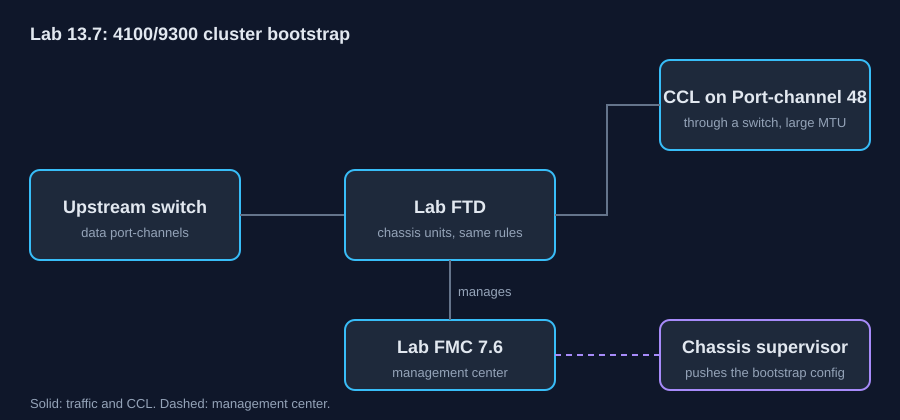

# Lab: Plan a Firepower 4100/9300 cluster, from hardware rules to bootstrap

Video: [Cisco FMC & FTD: Firepower 4100/9300 Clustering: Design and Configuration](https://youtu.be/IDfgMjM4Oic)
Reference: Cisco Secure Firewall Management Center Device Configuration Guide 7.6,
chapter 14 (PDF pages 753-791). Check the guide for your exact version.

> **Use a lab FMC/FTD or a virtual lab, never production.**

## Goal

Get the chassis-level work right, because that is where a 4100/9300 cluster succeeds or fails. You apply the hardware rules for native and container instances, design the CCL, and walk the bootstrap from image upload to registration.

## Background

- Native instances use a whole module or chassis; container instances share a module and use resource profiles. Native: 4100 chassis all the same model, 9300 modules all the same type, up to 16 nodes. Container: you can mix 4100 models or 9300 module types, up to 6 nodes. A 4100 and a 9300 are never in the same cluster.
- On a 9300 all 3 modules must belong to the cluster. For container instances the cluster needs a container instance on all 3 modules. For native instances all modules belong to the cluster, including empty slots.
- The CCL is an isolated network for state, keepalives and configuration sync. For native instances it is created automatically on Port-channel 48. Between two chassis do not connect the CCL directly; use a switch so the healthy chassis's CCL stays up when the other fails or reloads.
- The CCL MTU is not set automatically on this platform. Configure it at least 100 bytes above the data interface MTU. Avoid values between 2561 and 8362; 9184 is the recommended value.
- Shared-type interfaces are not supported with clustering. Plan for about 80 percent of the combined throughput.
- Bootstrap: upload the threat defense image to the chassis. Before the first container instance on a module that previously ran a native instance, reinitialize the security module so the disk is formatted correctly (any existing logical device is deleted). The chassis supervisor pushes a minimal bootstrap configuration to each unit: cluster name, CCL interface, management IP and registration details. Native clusters use the chassis ID; container instances use a resource profile (the default is Default-Small).
- Health: the chassis supervisor checks the application every second, and nodes exchange heartbeats over the CCL. A node that loses contact, or has a failed monitored interface, leaves or is removed.

## Prerequisites

- Lab Firepower 4100 or 9300 chassis (or a paper design) and a lab management center.
- A lab switch for the CCL.

Values you will use (keep them as placeholders in anything you share, never commit real values):

| Placeholder | What it is |
|---|---|
| `<CLUSTER_NAME>` | name of the lab cluster |
| `<CLUSTER_KEY>` | shared cluster key (secret; never commit) |
| `<CCL_MTU>` | CCL MTU, at least data MTU plus 100 |
| `<MGMT_IP>` | management address for each unit |
| `<RESOURCE_PROFILE>` | container resource profile, if used |

## Steps

### Part 1: design

1. Decide native or container instances and check the hardware mixing and size limits.
2. For a 9300, confirm the plan covers all 3 modules.
3. Design the CCL: Port-channel 48 to a switch with `<CCL_MTU>` (9184 recommended).

### Part 2: bootstrap

4. Upload the threat defense image to the chassis.
5. For container instances on a module that previously ran a native instance, reinitialize the module.
6. Create the cluster from the chassis with `<CLUSTER_NAME>`, the CCL and management details (`<MGMT_IP>`, and `<RESOURCE_PROFILE>` for container instances), and `<CLUSTER_KEY>`. Then register it in the management center.

### Part 3: verify

7. Run `show cluster info` and `show cluster info health` and confirm every unit and one control node.
8. Confirm no shared-type data interfaces are assigned.

## Where this lab follows the documentation

The video suggests the CCL MTU is set for you. On the Firepower 4100/9300 it is not: per the guide you configure the CCL MTU to be at least 100 bytes higher than the data interface MTU, avoid 2561 to 8362, and 9184 is recommended. Automatic CCL MTU sizing is a Secure Firewall 3100/4200 behavior. This lab follows the documentation.

## Check your work

Use [checklist.md](checklist.md). If something does not work, start with
[troubleshooting.md](troubleshooting.md).

## Clean up

Delete the lab logical devices and the cluster on the chassis, remove the lab Port-channel 48 CCL configuration from the switch, and remove the cluster from the management center.

---
*Always confirm behavior against the guide for your exact FMC/FTD version. Independent training by Hexward Labs; not affiliated with or endorsed by Cisco Systems.*
