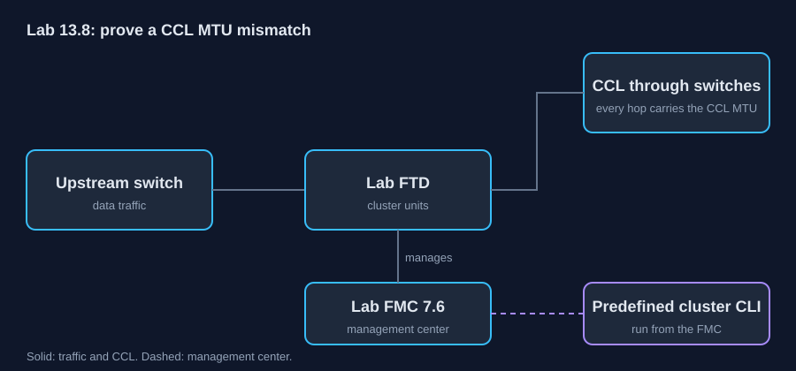

# Lab: Find and prove a CCL MTU mismatch

Video: [Cisco FMC & FTD: 4100/9300 Clustering: Management and Troubleshooting](https://youtu.be/uRdF1Dsswf4)
Reference: Cisco Secure Firewall Management Center Device Configuration Guide 7.6,
chapter 14 (PDF pages 792-824). Check the guide for your exact version.

> **Use a lab FMC/FTD or a virtual lab, never production.**

## Goal

Turn a silent loss of half your throughput into a short fix. You record each node's state, run the predefined cluster commands from the management center, and use a small ping against a CCL-sized ping to prove an MTU mismatch on the switch path.

## Background

- The CCL is the isolated link nodes use to share state, receive policy from the control node and keep connections synchronized. On the 4100/9300 it uses Port-channel 48 by default and should be a dedicated Layer 2 segment through switches. If it breaks, nodes lose shared state and the cluster fractures.
- Hardware recap: native instances need identical chassis (4100) or modules (9300); container instances can mix; never a 4100 with a 9300.
- In the management center, a healthy node shows In Sync in Cluster Live Status. Other states include Joining cluster, Pending Registration and Clustering is disabled; an ejected node shows clustering disabled and its traffic moves to the remaining nodes. The cluster health monitor dashboard separates the control node from data nodes and shows per-node load and trends.
- Classic trap: the CCL MTU should be at least 100 bytes above the data interface MTU, and every switch on the CCL path must carry that size. If the switch MTU is smaller, large CCL packets are dropped there. The guide lists this mismatch as a major cause of a node failing to join.
- You can run predefined cluster CLI commands from Device Management without SSH to every unit, including show running-config cluster, show cluster info, show cluster info health, show interface for the CCL interface, and a ping to the CCL IP at the CCL MTU size. Cluster Live Status also offers a CCL Ping that tests every other node at the maximum CCL MTU size.

## Prerequisites

- A lab 4100/9300 or virtual cluster you can safely disturb.
- Access to the switch that carries the CCL (lab only).

Values you will use (keep them as placeholders in anything you share, never commit real values):

| Placeholder | What it is |
|---|---|
| `<CCL_INTERFACE>` | the CCL interface name |
| `<CCL_IP>` | a peer node's CCL address |
| `<CCL_MTU>` | the configured CCL MTU |
| `<SWITCH_PORT>` | a switch port on the CCL path |

## Steps

### Part 1: baseline

1. Note the data MTU and the CCL MTU, and the MTU of every switch port on the CCL path (`<SWITCH_PORT>` and its peers).
2. Open Cluster Live Status and record each node's state.
3. Run the predefined cluster commands from the management center and save the output: `show running-config cluster`, `show cluster info`, `show cluster info health`, `show interface <CCL_INTERFACE>`.

### Part 2: prove the problem

4. Ping `<CCL_IP>` with a small packet, then with `ping <CCL_IP> size <CCL_MTU> repeat 2`. Compare the results.
5. Run the CCL Ping from Cluster Live Status and note which peers fail.

### Part 3: fix and confirm

6. If the large ping fails, correct the switch MTU on `<SWITCH_PORT>` (lab only), repeat the large ping and watch the node return to In Sync.

## Check your work

Use [checklist.md](checklist.md). If something does not work, start with
[troubleshooting.md](troubleshooting.md).

## Clean up

Restore any lab switch MTU you changed to the original value you recorded in Part 1.

---
*Always confirm behavior against the guide for your exact FMC/FTD version. Independent training by Hexward Labs; not affiliated with or endorsed by Cisco Systems.*
