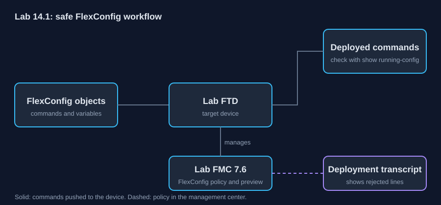

# Lab: A safe FlexConfig workflow, from CLI to verified deployment

Video: [Cisco FMC & FTD: FlexConfig: When to Use It and How to Manage It](https://youtu.be/QDGbceWxIvE)
Reference: Cisco Secure Firewall Management Center Device Configuration Guide 7.6,
chapter 81 (PDF pages 2741-2775). Check the guide for your exact version.

> **Use a lab FMC/FTD or a virtual lab, never production.**

## Goal

Use FlexConfig as a last resort and still stay in control. You find the exact CLI, check for a predefined object, build the objects and policy, read the preview line by line, deploy, verify on the device and plan how to remove it.

## Background

- FlexConfig deploys threat defense features the device supports but the management center GUI does not yet expose. The management center does not validate these commands the way it validates managed features, so you own the testing.
- Use the GUI for anything the management center already manages (access control, NAT, interfaces, managed routing, QoS). FlexConfig examples where the GUI does not help include WCCP and cluster PAT tuning with cluster-member-limit.
- Cluster example: when distributing PAT port blocks, the control node plans for the maximum cluster size of 16 members. In a two- or three-node cluster many blocks stay unused. The FlexConfig command cluster-member-limit lowers the planned size. Clustering limits still apply: features unsupported with clustering, such as remote access VPN, DHCP client and server, and virtual tunnel interfaces, cannot be added through FlexConfig.
- FlexConfig objects contain the device commands, variables and scripting instructions; use a predefined object when one exists. Text objects hold values (single or multiple) used as variables inside FlexConfig objects (Objects > FlexConfig > Text Object). The FlexConfig policy lists the objects to deploy (prepend or append) and is assigned to target devices.
- Workflow: determine the exact CLI, check predefined objects, create or edit text objects, create FlexConfig objects only if needed, build the policy and set target devices, Preview Config, deploy, verify, remove when no longer needed.
- Unassigning a FlexConfig policy might not remove the commands it already deployed, so plan the negate commands. A FlexConfig mistake can roll back all changes in that deployment attempt.

## Prerequisites

- A lab management center and a lab threat defense device.
- The exact CLI for a feature the GUI does not manage in your version, taken from the guide.

Values you will use (keep them as placeholders in anything you share, never commit real values):

| Placeholder | What it is |
|---|---|
| `<FEATURE_CLI>` | the exact command from the guide |
| `<TEXT_OBJECT>` | name of the lab text object |
| `<FLEXCONFIG_OBJECT>` | name of the lab FlexConfig object |
| `<FLEXCONFIG_POLICY>` | name of the lab FlexConfig policy |
| `<DEVICE_NAME>` | the lab threat defense |

## Steps

### Part 1: prepare

1. Pick a feature that the GUI does not manage in your version and write down `<FEATURE_CLI>` from the guide.
2. Check the predefined FlexConfig objects first.
3. Create `<TEXT_OBJECT>` for any value you want to reuse, then `<FLEXCONFIG_OBJECT>` that references it.

### Part 2: assign and preview

4. Create `<FLEXCONFIG_POLICY>`, add the object and set `<DEVICE_NAME>` as the only target.
5. Use Preview Config and read every generated line.

### Part 3: deploy and verify

6. Deploy, then read the deployment transcript for rejected commands.
7. On the device run `show running-config` and confirm the command is present.

### Part 4: remove

8. Remove the object from the policy and check whether the command stays on the device. If it does, write down the negate command you would deploy.

## Where this lab follows the documentation

The video says text objects hold the CLI commands. The commands live in FlexConfig objects; text objects only hold values used as variables. It also ties command support to Snort 2 versus Snort 3; FlexConfig pushes threat defense CLI, so support depends on the threat defense software version. And the guide does not say the GUI setting wins over an overlapping FlexConfig command: it says a FlexConfig mistake can roll back all changes in the deployment attempt and that you should not use FlexConfig for features the management center already manages. This lab follows the documentation.

## Check your work

Use [checklist.md](checklist.md). If something does not work, start with
[troubleshooting.md](troubleshooting.md).

## Clean up

Remove the lab FlexConfig policy assignment, deploy the negate commands if the feature stays on the device, delete the lab objects and deploy again.

---
*Always confirm behavior against the guide for your exact FMC/FTD version. Independent training by Hexward Labs; not affiliated with or endorsed by Cisco Systems.*
