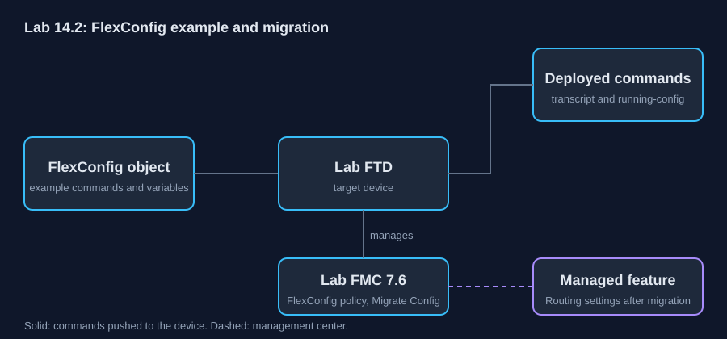

# Lab: Deploy a FlexConfig example and review what can migrate

Video: [Cisco FMC & FTD: FlexConfig: Examples, Migration, and Configuration Review](https://youtu.be/pZ0yHrzGAfs)
Reference: Cisco Secure Firewall Management Center Device Configuration Guide 7.6,
chapter 81 (PDF pages 2776-2786). Check the guide for your exact version.

> **Use a lab FMC/FTD or a virtual lab, never production.**

## Goal

Use a FlexConfig example safely and keep your configuration tidy over time. You match an example to your hardware and software, deploy it with preview and transcript checks, and review which FlexConfig objects could move to managed features after an upgrade.

## Background

- FlexConfig examples are tied to specific hardware and software. For instance, automatic hardware bypass on power failure only applies to an ISA 3000 with bypass-capable port pairs; on any other model the commands fail.
- Building blocks: a FlexConfig object holds the commands and variables; text objects or policy object variables map values such as interfaces into the commands; a FlexConfig policy lists the objects and sets the target devices.
- Use Preview Config in the FlexConfig policy (or the preview during deploy) to see the generated lines. The deployment transcript shows how rules are translated to commands. A FlexConfig error can roll back every change in that deployment attempt.
- Migration to managed features (7.3 and later, for ECMP, VXLAN and EIGRP): after upgrade the existing FlexConfig configuration is retained; FlexConfig > Edit > Migrate Config helps move it (it does not remove the FlexConfig objects); verify the result under the device's Routing settings; then duplicate the FlexConfig policy, remove the migrated CLI objects from the copy, assign the copy and deploy. If the same policy is configured in both places, the management center shows an error at deployment.
- A capability may start as FlexConfig-only and later gain a GUI page. At each upgrade, review your FlexConfig policies and move features to the GUI when your version supports them.

## Prerequisites

- A lab management center and a lab threat defense whose hardware matches the example you choose.

Values you will use (keep them as placeholders in anything you share, never commit real values):

| Placeholder | What it is |
|---|---|
| `<EXAMPLE_NAME>` | the guide's FlexConfig example you chose |
| `<FLEXCONFIG_OBJECT>` | name of the lab FlexConfig object |
| `<DEVICE_NAME>` | the lab threat defense |
| `<INTERFACE>` | the interface value used as a variable |

## Steps

### Part 1: choose and build

1. Choose `<EXAMPLE_NAME>` from the guide that fits your lab hardware and confirm your threat defense version supports the commands.
2. Create `<FLEXCONFIG_OBJECT>` and any text objects it needs (for example `<INTERFACE>`).

### Part 2: deploy

3. Assign the policy to `<DEVICE_NAME>` only and use Preview Config.
4. Deploy and read the transcript for rejected lines.
5. Confirm the lines in `show running-config`.

### Part 3: review for migration

6. List every FlexConfig object in use and note which features might be managed in a later release (ECMP, VXLAN and EIGRP are the documented migration cases from 7.3).
7. If you have such a case, use Migrate Config, verify under Routing, then follow the duplicate-and-remove steps above.

## Where this lab follows the documentation

The video links command support to Snort 2 versus Snort 3 and says text objects hold the bypass commands. Support depends on the threat defense software version, and the commands live in FlexConfig objects. The video also says a legacy FlexConfig can silently overwrite a managed feature after migration. The guide does not describe that; its migration section (7.3 and later) covers ECMP, VXLAN and EIGRP, says the FlexConfig configuration is retained after upgrade, offers Migrate Config, and says that if the same policy is configured in both places the management center shows an error at deployment. This lab follows the documentation.

## Check your work

Use [checklist.md](checklist.md). If something does not work, start with
[troubleshooting.md](troubleshooting.md).

## Clean up

Remove the lab FlexConfig assignment, deploy any negate commands, delete the lab objects and deploy again.

---
*Always confirm behavior against the guide for your exact FMC/FTD version. Independent training by Hexward Labs; not affiliated with or endorsed by Cisco Systems.*
