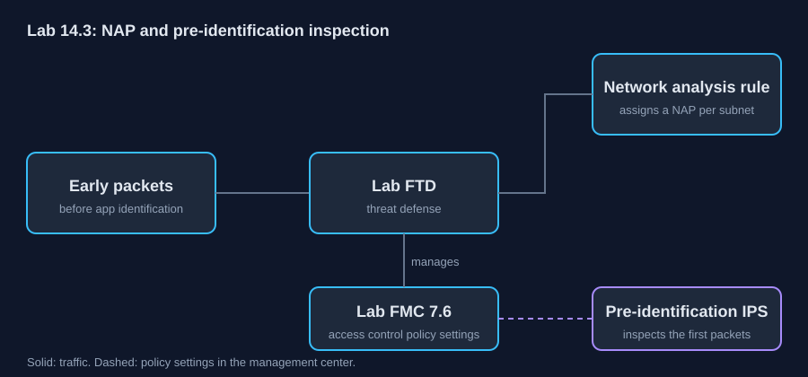

# Lab: Secure the pre-identification window with NAP and intrusion settings

Video: [Cisco FMC & FTD: Advanced Access Control and Network Analysis Policies](https://youtu.be/JRBFEt5FacE)
Reference: Cisco Secure Firewall Management Center Device Configuration Guide 7.6,
chapters 82 and 83 (PDF pages 2789-2806). Check the guide for your exact version.

> **Use a lab FMC/FTD or a virtual lab, never production.**

## Goal

Close the gap before the system knows the application. You record the current defaults, create a custom network analysis policy (NAP) and a network analysis rule for one lab subnet, compare and preview the change, deploy it, and look at the Automatic Application Bypass setting.

## Background

- The first packets of a connection pass before the system knows the application, and before an access control rule that depends on it can match. Two settings address this: the network analysis policy (NAP) and the intrusion policy used before the access control rule is determined.
- A NAP acts during preprocessing, before rules are evaluated (decoding, normalization, defragmentation, reassembly). The pre-identification intrusion policy inspects packets that pass before identification. Access control rules act after enough data is seen.
- Where to set them: edit the access control policy, Advanced, Network Analysis and Intrusion Policies. There you set the intrusion policy used before the access control rule is determined, the default network analysis policy, and network analysis rules (custom rules that assign a different NAP to specific traffic, for example by zone or network). The first matching rule applies; otherwise the default NAP is used.
- Check licensing for intrusion features and the inspection engine (Snort 2 or Snort 3): the available preprocessing settings depend on it.
- Automatic Application Bypass (AAB) is a device setting (Devices > Device Management > edit device > Advanced Settings; Bypass Threshold 250 to 60,000 ms, default 3000). It is a safety mechanism around Snort processing, not part of application identification.
- Change control: compare a policy with another policy or an earlier revision before deploying, use the deployment preview, generate policy reports for change records and use deployment history to roll back when needed.

## Prerequisites

- A lab management center, a lab threat defense and an access control policy you can edit.
- A lab subnet to apply the custom NAP to.

Values you will use (keep them as placeholders in anything you share, never commit real values):

| Placeholder | What it is |
|---|---|
| `<ACP_NAME>` | the lab access control policy |
| `<CUSTOM_NAP>` | name of the custom network analysis policy |
| `<LAB_SUBNET>` | the lab subnet the network analysis rule matches |
| `<DEVICE_NAME>` | the lab threat defense |

## Steps

### Part 1: record the defaults

1. Open `<ACP_NAME>` > Advanced > Network Analysis and Intrusion Policies.
2. Record the current intrusion policy used before the access control rule is determined and the default NAP.

### Part 2: add a custom NAP

3. Create `<CUSTOM_NAP>` and a network analysis rule that applies it to `<LAB_SUBNET>`.
4. Compare `<CUSTOM_NAP>` with its base policy or a previous revision.

### Part 3: deploy and check

5. Preview and deploy to `<DEVICE_NAME>`, then confirm intrusion events can appear for traffic early in a connection.
6. Open the device Advanced Settings and note whether AAB is enabled and its threshold.
7. Check the deployment history for the new revision.

## Where this lab follows the documentation

The video says the default network analysis policy is chosen in the Network Analysis Policies list. It is chosen in the access control policy's Advanced settings. The video also says Automatic Application Bypass is triggered by slow application identification. It is a device setting (off by default, default threshold 3000 ms); on threat defense the guide says AAB is only triggered when Snort is down, after which Snort restarts and troubleshooting data is generated. Traffic that is not yet identified is handled by the intrusion policy used before the access control rule is determined. This lab follows the documentation.

## Check your work

Use [checklist.md](checklist.md). If something does not work, start with
[troubleshooting.md](troubleshooting.md).

## Clean up

Restore the recorded default NAP and intrusion policy, delete the lab network analysis rule and `<CUSTOM_NAP>`, and deploy again.

---
*Always confirm behavior against the guide for your exact FMC/FTD version. Independent training by Hexward Labs; not affiliated with or endorsed by Cisco Systems.*
