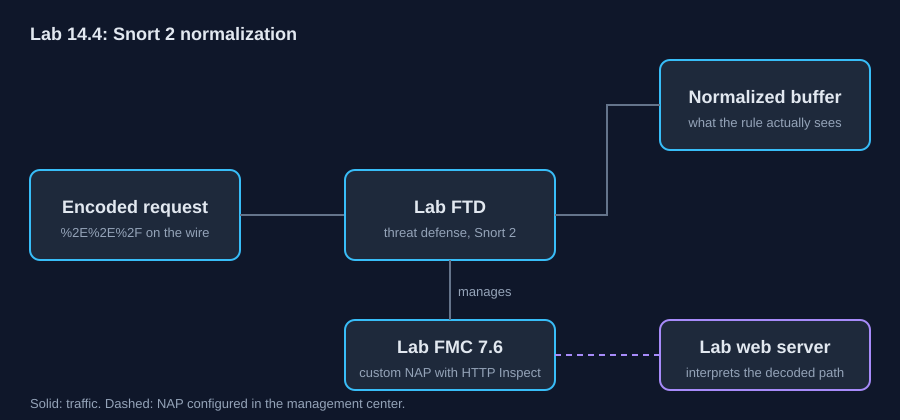

# Lab: See Snort 2 normalization change rule matching

Video: [Cisco FMC & FTD: Snort 2: HTTP, DNS, and FTP/Telnet Preprocessors](https://youtu.be/Ini0h4ADak0)
Reference: Cisco Secure Firewall Management Center Device Configuration Guide 7.6,
chapter 84 (PDF pages 2807-2808 and 2819-2844). Check the guide for your exact version.

> **Use a lab FMC/FTD or a virtual lab, never production.**

## Goal

Understand why a correct rule can fail to fire. You enable HTTP Inspect in a custom Snort 2 network analysis policy, add a server-level configuration, send an encoded request and compare what the rule sees.

## Background

- Payloads can be valid but compressed, chunked or encoded in ways that hide signatures. Snort 2 preprocessors decode and normalize traffic before rules are evaluated. For example, a request for /%2E%2E%2Fetc/passwd is normalized to /../etc/passwd and %20 in a URI becomes a literal space.
- Rules that inspect normalized HTTP buffers (for example http_uri) see the decoded value. A custom rule written to match %20 in the URI buffer will usually miss because the preprocessor already turned it into a space. Write rules for the normalized form unless you deliberately use a raw buffer such as http_raw_uri.
- Scope in the network analysis policy: HTTP Inspect has global options plus server-level options per web server; DNS has global inspection options; FTP and Telnet have global, Telnet, and FTP server-level and client-level options (command validation).
- These settings live in a Snort 2 custom network analysis policy and do not map 1:1 to Snort 3 inspectors, so confirm the engine version first. To normalize or drop traffic, the policy must allow traffic modification (Inline Mode) and the device must be deployed inline.

## Prerequisites

- A lab threat defense running Snort 2, deployed inline, with a lab web server behind it.
- A client that can send a raw HTTP request to the lab server.

Values you will use (keep them as placeholders in anything you share, never commit real values):

| Placeholder | What it is |
|---|---|
| `<CUSTOM_NAP>` | name of the custom network analysis policy |
| `<LAB_WEB_SERVER>` | the lab web server |
| `<LAB_CLIENT>` | the lab client |
| `<ACP_NAME>` | the lab access control policy |

## Steps

### Part 1: build the NAP

1. Confirm the device uses Snort 2 for this lab.
2. Create `<CUSTOM_NAP>` and enable HTTP Inspect.
3. Add a server-level configuration for `<LAB_WEB_SERVER>`.
4. Enable Inline Mode in the policy and commit the changes.

### Part 2: assign and deploy

5. Assign `<CUSTOM_NAP>` as the default NAP or through a network analysis rule in `<ACP_NAME>`, then deploy.

### Part 3: test

6. From `<LAB_CLIENT>` send an encoded traversal request to `<LAB_WEB_SERVER>` and review the intrusion events.
7. Compare a rule written against the normalized form with one written for the encoded form and note which one fires.

## Check your work

Use [checklist.md](checklist.md). If something does not work, start with
[troubleshooting.md](troubleshooting.md).

## Clean up

Restore the default NAP assignment, delete the lab custom NAP and test rules, and deploy again.

---
*Always confirm behavior against the guide for your exact FMC/FTD version. Independent training by Hexward Labs; not affiliated with or endorsed by Cisco Systems.*
