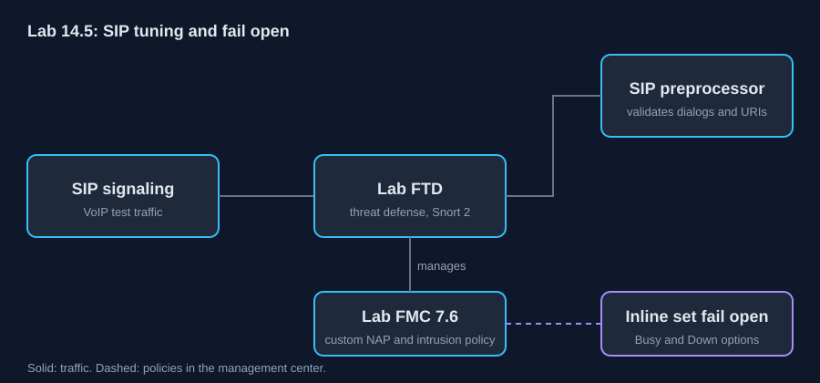

# Lab: Tune SIP and review Snort fail-open behavior

Video: [Cisco FMC & FTD: Snort 2: RPC, SIP, GTP, Email, SSH, and SSL Preprocessors](https://youtu.be/eKbkzyKgKdg)
Reference: Cisco Secure Firewall Management Center Device Configuration Guide 7.6,
chapter 84 (PDF pages 2808-2818 and 2845-2874). Check the guide for your exact version.

> **Use a lab FMC/FTD or a virtual lab, never production.**

## Goal

Tune only the decoders your network carries and know what happens when Snort is busy or down. You enable the SIP preprocessor in a custom Snort 2 NAP, set the related preprocessor rules, record the inline set Fail Open options and test with SIP traffic.

## Background

- Snort 2 application layer preprocessors decode and validate traffic before rules run: DCE/RPC (and Sun RPC) for RPC traffic; SIP for VoIP signaling (options such as maximum dialogs per session and maximum request URI length); GTP for mobile core traffic; IMAP, POP and SMTP for email protocols and attachments; SSH to detect SSH exploit attempts and protocol anomalies; SSL to inspect the handshake.
- The SSH and SSL preprocessors do not decrypt traffic. To inspect encrypted content you need a decryption policy.
- Passive deployments can only alert. Inline deployments with Inline Mode enabled in the NAP can drop malformed packets when the matching preprocessor rules are set to drop in the intrusion policy.
- Snort Fail Open on inline sets: by default traffic passes without inspection when Snort is down and is dropped when Snort is busy. Each option (Busy, Down) can be changed per inline set to match your risk profile. On routed or transparent interfaces, behavior during a Snort restart is different (see the guide's Snort restart traffic behavior table).
- Snort 3 uses inspectors with a different configuration model. Do not apply these Snort 2 NAP settings to a Snort 3 device.

## Prerequisites

- A lab threat defense running Snort 2, deployed inline.
- A way to send test SIP traffic in the lab.

Values you will use (keep them as placeholders in anything you share, never commit real values):

| Placeholder | What it is |
|---|---|
| `<CUSTOM_NAP>` | name of the custom network analysis policy |
| `<INTRUSION_POLICY>` | the lab intrusion policy |
| `<INLINE_SET>` | the lab inline set |

## Steps

### Part 1: build

1. Confirm the device runs Snort 2.
2. Create `<CUSTOM_NAP>`, enable the SIP preprocessor and review its options.
3. Enable Inline Mode and commit the changes.

### Part 2: rules and fail open

4. In `<INTRUSION_POLICY>`, set the relevant SIP preprocessor rules to generate events (or drop, in the lab).
5. Open `<INLINE_SET>` > Advanced and record the Snort Fail Open Busy and Down settings.

### Part 3: deploy and test

6. Deploy and send test SIP traffic; review intrusion events.
7. Write down which protocols on your network need preprocessors and which can stay off.

## Where this lab follows the documentation

The video suggests the SSH and SSL preprocessors reveal what is inside an encrypted tunnel. They do not decrypt. The SSH preprocessor detects specific SSH exploits and anomalies, and the SSL preprocessor inspects the handshake so the system can stop inspecting encrypted payload. To inspect encrypted content you need a decryption policy. This lab follows the documentation.

## Check your work

Use [checklist.md](checklist.md). If something does not work, start with
[troubleshooting.md](troubleshooting.md).

## Clean up

Restore the original preprocessor rule actions and inline set Fail Open settings, delete `<CUSTOM_NAP>` and deploy again.

---
*Always confirm behavior against the guide for your exact FMC/FTD version. Independent training by Hexward Labs; not affiliated with or endorsed by Cisco Systems.*
