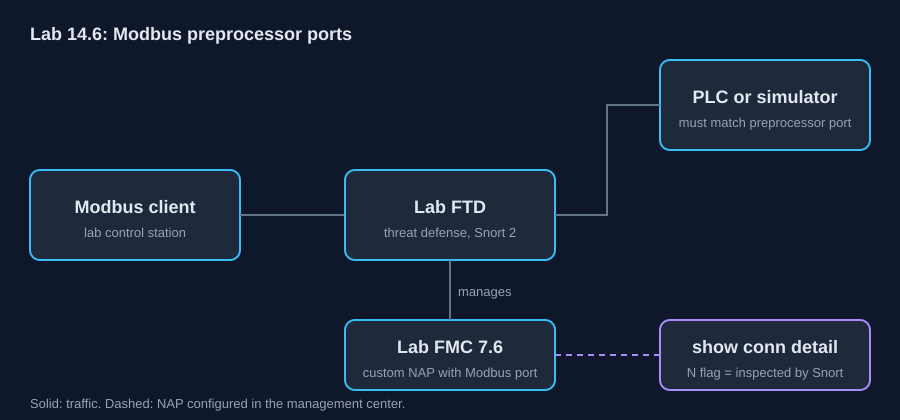

# Lab: Align the Modbus preprocessor with the real PLC ports

Video: [Cisco FMC & FTD: Snort 2 for OT: Modbus, DNP3, CIP, and S7](https://youtu.be/ogFACtAY8lE)
Reference: Cisco Secure Firewall Management Center Device Configuration Guide 7.6,
chapter 85 (PDF pages 2875-2886). Check the guide for your exact version.

> **Use a lab FMC/FTD or a virtual lab, never production.**

## Goal

Make sure industrial traffic is actually decoded. You inventory the protocols and ports, set the Modbus preprocessor port to match the PLC port in a custom Snort 2 NAP, deploy in a planned window and prove inspection with the connection flags.

## Background

- Snort 2 SCADA preprocessors (Modbus, DNP3, CIP and S7Commplus) decode industrial traffic so intrusion rules for those protocols can evaluate it. They decode traffic for intrusion rules; the access control rule decision itself is not made on the decoded Modbus fields.
- Ports decide what gets decoded. The Modbus preprocessor uses TCP port 502 by default. If the PLCs talk on a custom port such as 5020 and the preprocessor still watches 502, that traffic is treated as generic TCP and Modbus rules never see it.
- These are Snort 2 network analysis policy settings; they do not carry over to Snort 3. Check licensing requirements for intrusion features in your version.
- Deploying network analysis policy changes can restart the Snort process. What happens to traffic during a restart depends on your interfaces and the Snort Fail Open settings, so schedule SCADA policy changes in a maintenance window.

## Prerequisites

- A lab threat defense running Snort 2, a lab PLC or Modbus simulator and a lab Modbus client.
- In real projects: a protocol and port inventory agreed with the control engineers.

Values you will use (keep them as placeholders in anything you share, never commit real values):

| Placeholder | What it is |
|---|---|
| `<PLC_IP>` | address of the lab PLC or simulator |
| `<PLC_PORT>` | the TCP port the PLC actually uses (for example a custom port) |
| `<CUSTOM_NAP>` | name of the custom network analysis policy |
| `<INTRUSION_POLICY>` | the lab intrusion policy |

## Steps

### Part 1: inventory

1. List the industrial protocols and ports in your lab, including `<PLC_PORT>`.
2. Confirm the device runs Snort 2.

### Part 2: configure

3. Edit `<CUSTOM_NAP>`, enable the Modbus preprocessor and set its port to `<PLC_PORT>`.
4. Enable the related Modbus intrusion rules in `<INTRUSION_POLICY>` if you want events.

### Part 3: deploy and prove

5. Deploy in a planned window and watch for the Snort restart warning.
6. Generate Modbus traffic and run `show conn address <PLC_IP> detail`. Look for the N flag (inspected by Snort).
7. Change the preprocessor port back to the default on purpose and repeat the test to see the difference.

## Where this lab follows the documentation

The video says show conn output contains the text inspect snort. It does not; use show conn address with the PLC address and detail, and look for the N flag, which the flag legend defines as inspected by Snort. The SCADA preprocessors also decode traffic for intrusion rules; the access control decision is not made on the decoded Modbus fields. This lab follows the documentation.

## Check your work

Use [checklist.md](checklist.md). If something does not work, start with
[troubleshooting.md](troubleshooting.md).

## Clean up

Restore the original preprocessor ports and rule states in the lab policies and deploy again in a maintenance window.

---
*Always confirm behavior against the guide for your exact FMC/FTD version. Independent training by Hexward Labs; not affiliated with or endorsed by Cisco Systems.*
