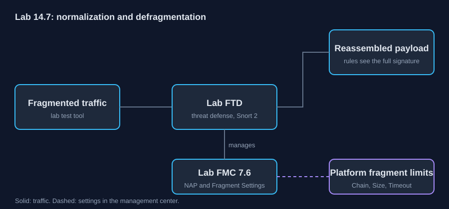

# Lab: Review checksum, defragmentation and inline normalization settings

Video: [Cisco FMC & FTD: Transport/Network Preprocessing: Normalization and Defragmentation](https://youtu.be/dUiIW6z1n8M)
Reference: Cisco Secure Firewall Management Center Device Configuration Guide 7.6,
chapter 86 (PDF pages 2887-2908). Check the guide for your exact version.

> **Use a lab FMC/FTD or a virtual lab, never production.**

## Goal

Understand how fragments and odd packets are rebuilt before rules run, and which limits belong to which feature. You review checksum verification, IP defragmentation and inline normalization, record the platform fragment settings and test with fragmented traffic.

## Background

- Checksum verification can verify protocol-level checksums (IP, TCP, UDP, ICMP). In an inline deployment you can configure it to drop packets with invalid checksums. Tune it carefully so you do not drop legitimate traffic.
- IP defragmentation (Snort 2 preprocessor) reassembles fragments so rules can match the complete payload and detects fragment anomalies. Options: Preallocated Fragments, Networks, Policy, Timeout, Min TTL, Detect Anomalies, Overlap Limit and Minimum Fragment Size. On threat defense routed and transparent interfaces, Policy, Detect Anomalies and Overlap Limit are ignored.
- Threat defense fragment settings are separate: Devices > Platform Settings > Fragment Settings control how many fragments the device accepts (by default Chain 24 per IP packet, Size 200 awaiting reassembly, Timeout 5 seconds). They are not defaults of the Snort 2 IP Defragmentation preprocessor.
- Inline normalization standardizes IP and TCP fields so the IPS and the destination host interpret the same data, for example clearing TCP reserved bits, clearing the urgent pointer and normalizing TCP payload. To normalize or drop packets, enable Inline Mode in the NAP and deploy the device inline. Some options are ignored on routed and transparent interfaces.
- These are Snort 2 preprocessor settings; confirm the engine version before applying them.

## Prerequisites

- A lab threat defense running Snort 2, deployed inline.
- A lab tool that can send fragmented test traffic.

Values you will use (keep them as placeholders in anything you share, never commit real values):

| Placeholder | What it is |
|---|---|
| `<CUSTOM_NAP>` | name of the custom network analysis policy |
| `<DEVICE_NAME>` | the lab threat defense |
| `<LAB_HOST>` | the lab target host |

## Steps

### Part 1: review

1. Confirm the device runs Snort 2.
2. In `<CUSTOM_NAP>`, review Checksum Verification and decide which checksums to verify or drop.
3. Review IP Defragmentation options and note which are ignored on routed or transparent interfaces.

### Part 2: configure

4. Enable Inline Normalization and Inline Mode for an inline lab segment.
5. Open Devices > Platform Settings > Fragment Settings for `<DEVICE_NAME>` and record Chain, Size and Timeout.

### Part 3: test

6. Deploy and send fragmented test traffic to `<LAB_HOST>` with your lab tool; review intrusion events and `show asp drop`.

## Where this lab follows the documentation

The video presents 24 fragments per IP packet and 200 fragments awaiting reassembly as defaults of the Snort 2 IP Defragmentation preprocessor. They are the threat defense's own fragment settings (Platform Settings > Fragment Settings: Chain 24, Size 200, Timeout 5 seconds). The guide does not describe a full-fragment-reassembly switch in the preprocessor or say fragment sets are passed on unreassembled. This lab follows the documentation.

## Check your work

Use [checklist.md](checklist.md). If something does not work, start with
[troubleshooting.md](troubleshooting.md).

## Clean up

Restore the original NAP and fragment settings, delete `<CUSTOM_NAP>` and deploy again.

---
*Always confirm behavior against the guide for your exact FMC/FTD version. Independent training by Hexward Labs; not affiliated with or endorsed by Cisco Systems.*
