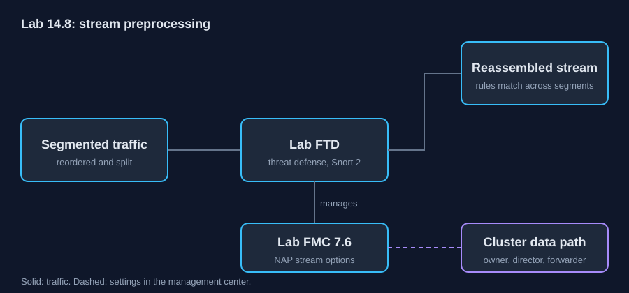

# Lab: Review TCP and UDP stream preprocessing and cluster data path checks

Video: [Cisco FMC & FTD: Transport/Network Preprocessing: TCP and UDP Streams](https://youtu.be/PjsobC8yI6g)
Reference: Cisco Secure Firewall Management Center Device Configuration Guide 7.6,
chapter 86 (PDF pages 2909-2922). Check the guide for your exact version.

> **Use a lab FMC/FTD or a virtual lab, never production.**

## Goal

Let rules inspect the data the server will actually receive, and keep stream tuning separate from the cluster data path. You review the TCP and UDP stream options in a Snort 2 NAP, check cluster health, and choose the TCP MSS deliberately.

## Background

- Attackers split and reorder segments so no single packet carries a full signature. Stream reassembly lets intrusion rules match across packet boundaries. These stream settings are Snort 2 network analysis policy settings and should not be assumed to carry over to Snort 3.
- TCP stream options include Policy (target-based reassembly per host OS), Timeout (1 to 86400 seconds), Maximum TCP Window, Overlap Limit, Flush Factor, Stateful Inspection Anomalies, TCP Session Hijacking, Consecutive Small Segments, Small Segment Size, Require TCP 3-Way Handshake and the Perform Stream Reassembly settings for client, server or both ports or services.
- UDP has no sessions, so the system tracks a session from the first packet until a configurable timer expires. UDP stream preprocessing does not generate events of its own.
- Cluster connection ownership is a separate topic, the data path. For TCP, the node that receives the SYN becomes the owner and encodes owner information in a SYN cookie; if the SYN-ACK lands on another node (the forwarder) it is forwarded over the cluster control link to the owner, which sends a state update to the director. For UDP, a node with no flow queries the director, which returns the owner, and the forwarder redirects the packet to the owner.
- Two cluster settings to keep in mind: do not disable TCP sequence randomization in a cluster (some SYN-ACK packets can be dropped and sessions fail to establish); and the TCP MSS defaults to 1380 bytes, leaving room for up to 120 bytes of IPv4 IPsec VPN overhead in a 1500-byte MTU. Change it with the Sysopt_Basic FlexConfig object. If the device is not an IPsec endpoint, the guide suggests disabling the MSS limit and accepting the value the endpoints negotiate.
- Traffic blocked earlier (for example by an access control rule or a block default action) or fastpathed by a prefilter rule is not deep-inspected. Decrypted TLS traffic follows its own handling.

## Prerequisites

- A lab threat defense running Snort 2, and optionally a lab cluster.
- A lab tool that can send segmented test traffic.

Values you will use (keep them as placeholders in anything you share, never commit real values):

| Placeholder | What it is |
|---|---|
| `<CUSTOM_NAP>` | name of the custom network analysis policy |
| `<LAB_HOST>` | the lab target host |
| `<MSS_VALUE>` | the TCP MSS you decide to use |

## Steps

### Part 1: review the NAP

1. Confirm the device runs Snort 2.
2. Open `<CUSTOM_NAP>` and review TCP Stream Configuration: Policy, Timeout and the Perform Stream Reassembly ports.
3. Review UDP Stream Configuration and note the timeout.

### Part 2: cluster and MSS

4. If you have a lab cluster, confirm health with `show cluster info` before changing anything and leave TCP sequence randomization enabled.
5. Decide `<MSS_VALUE>` for IPsec or non-IPsec use; note it is changed through the Sysopt_Basic FlexConfig object.

### Part 3: test

6. Deploy, send segmented test traffic to `<LAB_HOST>` and review intrusion events, `show conn` and `show asp drop`.
7. Use `packet-tracer` and connection events to confirm the test traffic was not blocked or fastpathed before inspection.

## Where this lab follows the documentation

Most of the video describes how a threat defense cluster assigns connection ownership (owner, director, forwarder). That is the cluster data path, not the Snort 2 TCP or UDP stream preprocessor, and the stream preprocessor does not enforce cluster ownership for UDP. The stream preprocessors are configured in the Snort 2 network analysis policy. This lab keeps the two topics separate and follows the documentation.

## Check your work

Use [checklist.md](checklist.md). If something does not work, start with
[troubleshooting.md](troubleshooting.md).

## Clean up

Restore the original NAP and MSS settings, delete `<CUSTOM_NAP>` and deploy again.

---
*Always confirm behavior against the guide for your exact FMC/FTD version. Independent training by Hexward Labs; not affiliated with or endorsed by Cisco Systems.*
