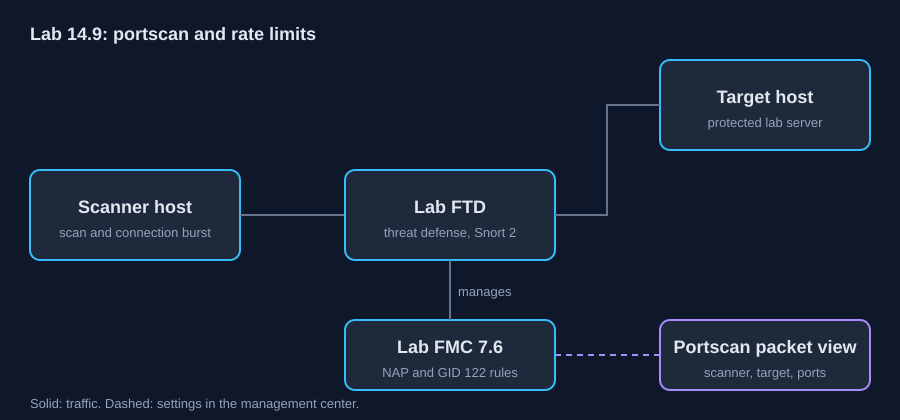

# Lab: Detect a portscan and limit abusive connection rates

Video: [Cisco FMC & FTD: Snort 2: Portscan Detection and Rate-Based Attack Prevention](https://youtu.be/xvooPeKRnXc)
Reference: Cisco Secure Firewall Management Center Device Configuration Guide 7.6,
chapter 87 (PDF pages 2923-2942). Check the guide for your exact version.

> **Use a lab FMC/FTD or a virtual lab, never production.**

## Goal

Get early warning of reconnaissance without causing an outage. You enable portscan detection, choose the sensitivity level, enable the matching rules, record a traffic baseline and add conservative rate-based thresholds, then test with a scan and a connection burst.

## Background

- These are Snort 2 settings. Cisco recommends Snort 3, which has its own portscan feature (introduced in 7.2.0). Do not assume Snort 2 values apply to Snort 3.
- Portscan types: portscan (one host to one host, many ports), port sweep (one host to many hosts), decoy portscan (spoofed sources mixed with the real one) and distributed portscan (many hosts to one host). Protocols: TCP, UDP, ICMP and IP.
- Sensitivity: Low detects only negative responses from targeted hosts (fewest false positives, but slow and filtered scans may be missed); Medium detects scans by the number of connections to a host, so filtered scans are caught (busy hosts such as NAT devices or proxies can cause false positives); High detects scans within a time window, the level for slow time-based scans, and needs tuning with Watch IP and Ignore Scanners.
- Fields: Protocol, Scan Type, Sensitivity Level, Watch IP, Ignore Scanners, Ignore Scanned, Detect Ack Scans. TCP and UDP stream processing must be enabled to detect scans over those protocols. Portscan events require the rules with GID 122 (SIDs 1 to 27) enabled in the intrusion policy. The portscan packet view shows Priority Count, Connection Count, IP Count, Scanner and Scanned IP ranges, Port/Proto Count and range, and Open Ports.
- Rate-based attack prevention is configured in the network analysis policy (Specific Threat Detection): SYN attack prevention protects hosts against SYN floods; control of simultaneous connections limits connections from a source or to a destination. A threshold and timeout define when the action starts and how long it lasts; inline devices can drop, passive devices only generate events. Related intrusion policy tools are dynamic rule states and the detection_filter rule keyword.
- Baseline first: a threshold set without knowing normal traffic rates can drop legitimate users and turn your own control into an outage.

## Prerequisites

- A lab threat defense running Snort 2 with an active IPS license.
- A lab host that can run a scan and generate a connection burst against a lab target.

Values you will use (keep them as placeholders in anything you share, never commit real values):

| Placeholder | What it is |
|---|---|
| `<CUSTOM_NAP>` | name of the custom network analysis policy |
| `<INTRUSION_POLICY>` | the lab intrusion policy |
| `<SCANNER_HOST>` | the lab host that runs the scan |
| `<TARGET_HOST>` | the lab target |

## Steps

### Part 1: portscan detection

1. Confirm the device runs Snort 2 and the IPS license is active.
2. In `<CUSTOM_NAP>`, enable TCP and UDP stream preprocessing.
3. Enable Portscan Detection under Specific Threat Detection and choose protocols, scan types and a sensitivity level.
4. In `<INTRUSION_POLICY>`, enable the GID 122 rules for the scan types you chose.

### Part 2: rate-based prevention

5. Record a traffic baseline, then configure Rate-Based Attack Prevention with conservative thresholds.

### Part 3: test

6. Deploy, run a scan from `<SCANNER_HOST>` against `<TARGET_HOST>` and a connection burst, then review intrusion events and the portscan packet view.
7. Confirm legitimate peak traffic is not dropped (`show conn count`, `show asp drop`).

## Where this lab follows the documentation

The video reverses the portscan sensitivity levels. Per the guide, Low detects only negative responses from targeted hosts, Medium detects scans by the number of connections to a host (so filtered scans are caught), and High detects scans based on a time window and needs tuning with Watch IP and Ignore Scanners. Portscan detection and rate-based attack prevention are configured in the Snort 2 network analysis policy (Specific Threat Detection), and portscan events require GID 122 rules enabled in the intrusion policy. This lab follows the documentation.

## Check your work

Use [checklist.md](checklist.md). If something does not work, start with
[troubleshooting.md](troubleshooting.md).

## Clean up

Disable the lab portscan and rate-based settings, restore the GID 122 rule states, delete `<CUSTOM_NAP>` and deploy again.

---
*Always confirm behavior against the guide for your exact FMC/FTD version. Independent training by Hexward Labs; not affiliated with or endorsed by Cisco Systems.*
