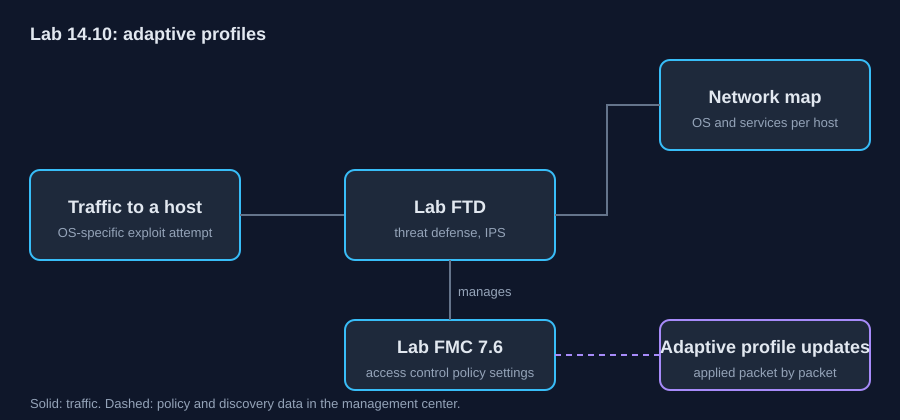

# Lab: Enable adaptive profiles so inspection knows the host

Video: [Cisco FMC & FTD: Adaptive Profiles and Host Context for Inspection](https://youtu.be/RKzK_HZmPnA)
Reference: Cisco Secure Firewall Management Center Device Configuration Guide 7.6,
chapter 88 (PDF pages 2943-2948). Check the guide for your exact version.

> **Use a lab FMC/FTD or a virtual lab, never production.**

## Goal

Feed host context from network discovery into inspection. You confirm discovery data for a lab server, set the Detection Enhancement Settings in the access control policy, review recommended rules separately, and compare intrusion events before and after.

## Background

- Adaptive profiles use host information from the network map (operating system, services) to tailor inspection to the destination host. Adaptive profiling must be enabled (its default) for application and file control and for intrusion rules that use service metadata.
- Where: access control policy, Advanced Settings, Detection Enhancement Settings. Enable turns adaptive profiles on; Enable Profile Updates refreshes host data used by inspection (for Snort 3, it must be selected together with Enable); Attribute Update Interval sets how often (in minutes) host data is refreshed; Networks selects which networks use profile updates (default is all).
- Prerequisite: a network discovery policy that discovers hosts and services (or imported host data). Without it there is no context to use.
- Deployment mode: in passive deployments, enable adaptive profile updates so IP traffic is defragmented and reassembled according to the destination host's OS. In inline deployments the guide recommends the inline normalization preprocessor with Normalize TCP Payload enabled instead.
- Profile updates are an access control policy setting applied to all intrusion policies it invokes; they never change rule states and act packet by packet on rules already enabled. Recommended rules are per intrusion policy and suggest enabling or disabling rules based on discovered hosts.
- Hosts change OS, roles and addresses. Keep network discovery running and the update interval sensible so host data stays fresh.

## Prerequisites

- A lab management center and threat defense with an active IPS license.
- A lab subnet covered by a network discovery policy and a lab server you can send test traffic to.

Values you will use (keep them as placeholders in anything you share, never commit real values):

| Placeholder | What it is |
|---|---|
| `<ACP_NAME>` | the lab access control policy |
| `<LAB_SUBNET>` | the lab subnet covered by network discovery |
| `<LAB_SERVER>` | the lab server used for the before and after test |
| `<UPDATE_INTERVAL>` | the attribute update interval in minutes |

## Steps

### Part 1: prerequisites

1. Confirm the inspection engine version and that the IPS license is active.
2. Confirm the network discovery policy covers `<LAB_SUBNET>` and check the host profile of `<LAB_SERVER>` (operating system and services).

### Part 2: configure

3. Edit `<ACP_NAME>` > Advanced Settings > Detection Enhancement Settings.
4. Ensure Enable is selected; select Enable Profile Updates (required together with Enable for Snort 3), set `<UPDATE_INTERVAL>` and Networks.
5. Optionally generate recommended rules in the intrusion policy and review the suggestions without applying them blindly.

### Part 3: compare

6. Deploy and compare intrusion events for traffic to `<LAB_SERVER>` before and after.

## Where this lab follows the documentation

The video places adaptive profiles in the intrusion policy's advanced settings and describes the update interval as a separate scheduled task. Adaptive profiles are configured in the access control policy (Advanced Settings, Detection Enhancement Settings), and the update interval is an option there (Attribute Update Interval). The video also suggests profile updates enable or disable rules; they never change rule states and only affect how already enabled rules are applied. Enabling or disabling rules based on hosts is the job of Cisco recommended rules, generated per intrusion policy. This lab follows the documentation.

## Check your work

Use [checklist.md](checklist.md). If something does not work, start with
[troubleshooting.md](troubleshooting.md).

## Clean up

Restore the recorded Detection Enhancement Settings, discard any lab recommended-rule changes and deploy again.

---
*Always confirm behavior against the guide for your exact FMC/FTD version. Independent training by Hexward Labs; not affiliated with or endorsed by Cisco Systems.*
