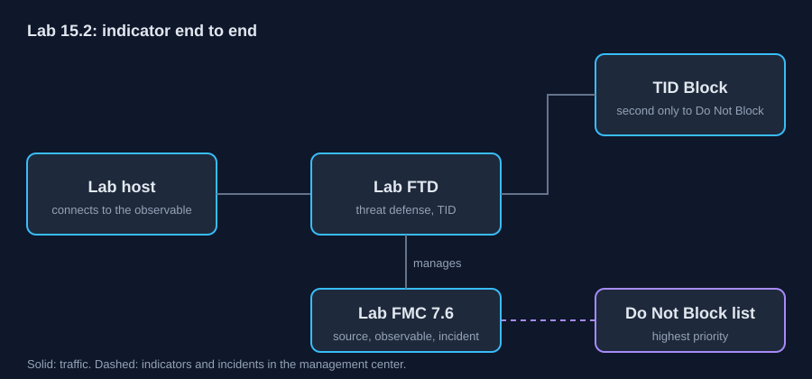

# Lab: Trace a threat intelligence indicator end to end

Video: [How to Analyze Threat Intelligence Director (TID) Indicators & Events in Cisco FMC](https://youtu.be/BJtOl3jQDCU)
Reference: Cisco Secure Firewall Management Center Device Configuration Guide 7.6,
chapter 89 (PDF pages 2965-2976). Check the guide for your exact version.

> **Use a lab FMC/FTD or a virtual lab, never production.**

## Goal

Close an indicator ticket with evidence. You add a test source with one observable set to Monitor, generate traffic and review the source, observable and incident, switch the observable to Block, repeat, then add the address to the Do Not Block list and see that no incident is created.

## Background

- A feed can flag an address and the connection can still succeed. Closing that kind of ticket needs evidence: is the source healthy, what action does the observable really carry, and what did the device actually do on the wire.
- Devices send events (and packet data if Transfer Packet is enabled when the device is added) to the management center, which correlates intrusion, discovery and connection data. TID observations come from this event flow.
- Investigation workflow: check the source (active and updating, indicator count); find the observable and its action (the observable's action is generally what is taken and may differ from the indicator's or source's); then review incidents, observations and the related connection or Security Intelligence events.
- Action prioritization, highest first: Security Intelligence Do Not Block, TID Block, Security Intelligence Block, TID Monitor, Security Intelligence Monitor. With SI Monitor and TID Monitor, the access control rules processed afterwards decide the final action.
- Other factors: STIX sources can be set only to Monitor at the source level, while individual simple indicators or observables can be set to Block. Paused publishing and the Do Not Block list also change the outcome. The configured action applies to partially and fully realized incidents.

## Prerequisites

- A lab management center and threat defense with an access control policy that supports TID (never production).
- A lab host and a lab destination address you control to use as the test observable.

Values you will use (keep them as placeholders in anything you share, never commit real values):

| Placeholder | What it is |
|---|---|
| `<TEST_SOURCE>` | the lab TID source |
| `<TEST_OBSERVABLE_IP>` | the lab destination used as the observable |
| `<CLIENT_IP>` | the lab host generating traffic |

## Steps

### Part 1: Monitor

1. Add `<TEST_SOURCE>` with one IP observable `<TEST_OBSERVABLE_IP>` and action Monitor.
2. Generate traffic to it from `<CLIENT_IP>` and review the source status, the observable and the incident.

### Part 2: Block

3. Change the observable action to Block and wait for publishing (5 to 10 minutes or more).
4. Repeat the test and compare the incident's action and the connection events.

### Part 3: Do Not Block

5. Add `<TEST_OBSERVABLE_IP>` to the Security Intelligence Do Not Block list and observe that no TID incident is created.

## Where this lab follows the documentation

Security Intelligence and Threat Intelligence Director act before access control rules, and the documented prioritization puts TID Block second only to the Security Intelligence Do Not Block list; a higher-priority access control Allow rule does not override a TID Block. Only when both Security Intelligence and TID are set to Monitor do the access control rules that follow decide the final action. If a TID-blocked indicator is getting through, check the Do Not Block list, the observable's own action (which can differ from its indicator or source), whether publishing is paused, and whether the traffic is trusted or bypasses inspection.

## Check your work

Use [checklist.md](checklist.md). If something does not work, start with
[troubleshooting.md](troubleshooting.md).

## Clean up

Remove the test source, observable and Do Not Block entry, then deploy again.

---
*Always confirm behavior against the guide for your exact FMC/FTD version. Independent training by Hexward Labs; not affiliated with or endorsed by Cisco Systems.*
