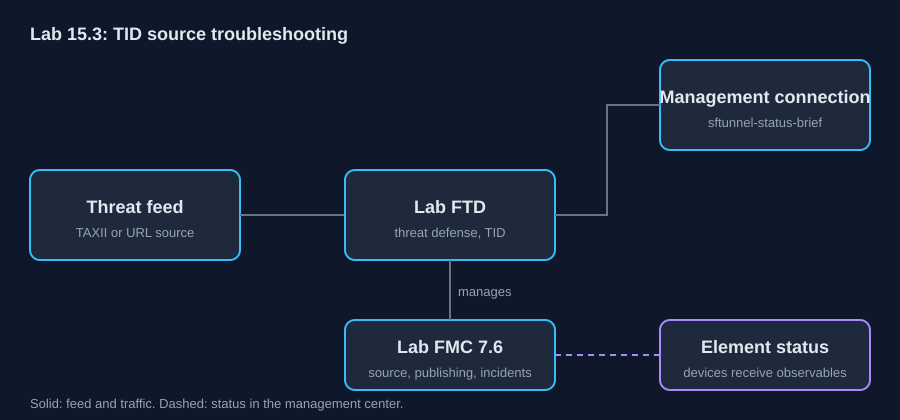

# Lab: Troubleshoot a TID source link by link

Video: [Cisco FMC Threat Intelligence Director (TID): Management & Troubleshooting Guide](https://youtu.be/Feiz15LA-6A)
Reference: Cisco Secure Firewall Management Center Device Configuration Guide 7.6,
chapter 89 (PDF pages 2977-2996). Check the guide for your exact version.

> **Use a lab FMC/FTD or a virtual lab, never production.**

## Goal

Check every link in the chain instead of guessing. You add a source and read its status, deliberately break its SSL settings and fix them, confirm the device management connection and element status, create a duplicate indicator, see two incidents, then pause one copy.

## Background

- A feed that silently stops updating, or a device that stops receiving published observables, leaves a gap no dashboard warns you about loudly. Managing TID means checking each link: the source, the management center, the managed device and the events that prove enforcement.
- Source problems: feed down, certificate or hostname verification failure, bad format (look at the source status in TID and the source's SSL Settings). Management center problems: ingestion or publishing paused, Do Not Block entries. Device problems: no management connection, so no published observables (element status in TID and `sftunnel-status-brief` on the device). Enforcement problems: traffic trusted or bypassed, wrong observable action (incidents, observations, connection events).
- Setup order: configure the access control policy to support TID, add sources (TAXII, URL or upload), configure each source's TLS/SSL settings if the server needs certificate-based authentication, then verify that indicators arrive and are published. Follow the guide's source requirements: supported STIX content or flat files with one observable type within size limits.
- Published observables reach devices over the management connection. On the threat defense CLI `sftunnel-status-brief` shows whether the connection to the management center is up. A healthy feed on the management center does not help if devices are disconnected.
- Observations are TID's record of seeing an observable in traffic. Matches to indicators create incidents, which carry the action taken (Monitored or Blocked) and can be partially or fully realized for complex indicators. Each instance of a duplicated indicator generates its own incident; pause publishing on all but one copy.

## Prerequisites

- A lab management center and threat defense with TID enabled in the access control policy (never production).
- A lab URL or TAXII source and a lab host that can generate test traffic.

Values you will use (keep them as placeholders in anything you share, never commit real values):

| Placeholder | What it is |
|---|---|
| `<TEST_SOURCE>` | the lab URL or TAXII source |
| `<SECOND_SOURCE>` | a second source containing the same indicator |
| `<DEVICE_NAME>` | the lab threat defense |
| `<CLIENT_IP>` | the lab host generating traffic |

## Steps

### Part 1: the source

1. Add `<TEST_SOURCE>` and note its status and indicator count.
2. Deliberately set the wrong server certificate or hostname verification in SSL Settings, observe the source status, then fix it.

### Part 2: the device

3. On `<DEVICE_NAME>` run `sftunnel-status-brief` and confirm the management connection is up.
4. Check element status in TID for the device.

### Part 3: duplicates and evidence

5. Add the same indicator from `<SECOND_SOURCE>`, observe two incidents, then pause publishing on one copy.
6. Generate test traffic from `<CLIENT_IP>` and review incident details, observations and connection events.

## Where this lab follows the documentation

An incident is not only created when traffic is dropped: the configured action (Monitor or Block) applies to the incident, and incidents for Monitor show Monitored as the action taken. The guide does not say that TID merges duplicate indicators and that Block always wins; it says each instance of a duplicated indicator generates its own incident, and you avoid duplicates by pausing publishing on all but one copy.

## Check your work

Use [checklist.md](checklist.md). If something does not work, start with
[troubleshooting.md](troubleshooting.md).

## Clean up

Remove the test sources and indicators, then deploy again.

---
*Always confirm behavior against the guide for your exact FMC/FTD version. Independent training by Hexward Labs; not affiliated with or endorsed by Cisco Systems.*
