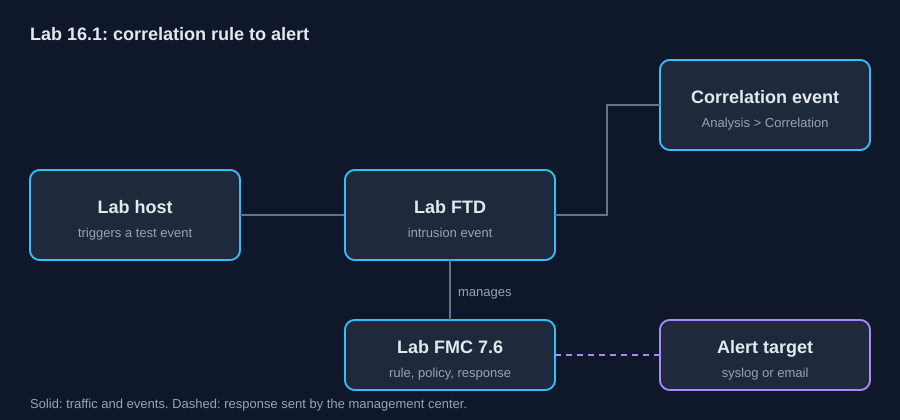

# Lab: Turn a correlation rule into an alert

Video: [Correlation Policies: Turning Events into Automated Responses](https://www.youtube.com/playlist?list=PLOQcyyK_fdoc)
Reference: Cisco Secure Firewall Management Center Administration Guide 7.6,
chapters "Correlation Policies", "Compliance Allow Lists" and "Traffic Profiles". Check the guide for your exact version.

> **Use a lab FMC/FTD or a virtual lab, never production.**

## Goal

Make the management center react to an event instead of waiting for someone to notice it. You create an alert response, write a correlation rule that matches a test intrusion event from one lab host, put both in a correlation policy, activate it and confirm the correlation event and the alert.

## Background

- Correlation rules trigger on events such as intrusion, connection, discovery, user activity or host input events, optionally with a host profile, user or snooze and inactive-period conditions.
- A correlation policy groups rules (and compliance allow lists) and assigns responses to each: alerts (email, SNMP, syslog) and remediations.
- Compliance allow lists define what is allowed on hosts (operating systems, applications, protocols) and fire when a host violates them. Traffic profiles learn normal traffic and trigger when traffic deviates.
- Correlation events are viewed under Analysis > Correlation > Correlation Events.

## Prerequisites

- A lab management center and threat defense with an intrusion policy applied (never production).
- A lab host that can trigger a harmless test intrusion rule, and a reachable lab syslog or mail relay for the alert.

Values you will use (keep them as placeholders in anything you share, never commit real values):

| Placeholder | What it is |
|---|---|
| `<CLIENT_IP>` | the lab host that triggers the test event |
| `<ALERT_TARGET>` | the lab syslog server or mail relay |
| `<RULE_NAME>` | the name of your test correlation rule |

## Steps

### Part 1: the response

1. Go to **Policies > Actions > Alerts** and create a syslog or email alert that sends to `<ALERT_TARGET>`.

### Part 2: the rule

2. Go to **Policies > Correlation**, open the Rule Management tab and click **Create Rule**.
3. Name it `<RULE_NAME>` and set the trigger to an intrusion event where the source IP is `<CLIENT_IP>`; save.

### Part 3: the policy

4. Back on **Policies > Correlation**, click **Create Policy**, add `<RULE_NAME>` and assign the alert as its response; save.
5. Activate the policy with its slider.

### Part 4: prove it

6. Trigger the test intrusion rule from `<CLIENT_IP>`.
7. Open **Analysis > Correlation > Correlation Events** and confirm the event, then confirm the alert arrived at `<ALERT_TARGET>`.

## Where this lab follows the documentation

A correlation rule does nothing on its own. It only produces correlation events and responses after it is added to a correlation policy and that policy is activated. Alert responses are created separately (Policies > Actions > Alerts) and then assigned to the rule inside the policy.

## Check your work

Use [checklist.md](checklist.md). If something does not work, start with
[troubleshooting.md](troubleshooting.md).

## Clean up

Deactivate and delete the test correlation policy, rule and alert.

---
*Always confirm behavior against the guide for your exact FMC/FTD version. Independent training by Hexward Labs; not affiliated with or endorsed by Cisco Systems.*
