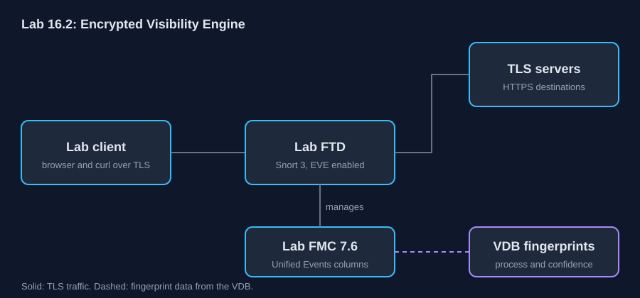

# Lab: Identify client processes in TLS without decrypting

Video: [Encrypted Visibility Engine: Identify Apps in Encrypted Traffic Without Decryption](https://www.youtube.com/playlist?list=PLOQcyyK_fdoc)
Reference: Cisco Secure Firewall Management Center Device Configuration Guide 7.6,
chapter "Encrypted Visibility Engine". Check the guide for your exact version.

> **Use a lab FMC/FTD or a virtual lab, never production.**

## Goal

Get visibility into encrypted sessions without a decryption policy. You enable EVE in the access control policy, keep malware blocking at the default threshold, generate TLS traffic from two different clients and compare the processes and threat confidence EVE reports.

## Background

- EVE reads the TLS Client Hello, the first packet of the handshake, which is sent before encryption starts. The fingerprint identifies the client process and a threat confidence from Very Low to Very High.
- With "Block Malware Processes Based on Threat Confidence Level" enabled, the default threshold is 99 percent; Cisco advises against thresholds below 50 percent.
- Sessions with Very High threat confidence can raise an indication of compromise when hosts are enabled in network discovery.
- From threat defense 7.6, EVE exception rules exempt traffic from EVE blocking by process name or destination network.

## Prerequisites

- A lab management center and a threat defense running Snort 3 with an IPS license (never production).
- A lab client with at least two TLS tools, for example a browser and curl.

Values you will use (keep them as placeholders in anything you share, never commit real values):

| Placeholder | What it is |
|---|---|
| `<CLIENT_IP>` | the lab client generating TLS traffic |
| `<ACP_NAME>` | the lab access control policy |

## Steps

### Part 1: enable EVE

1. Edit `<ACP_NAME>`, open **Advanced Settings** from the More drop-down and edit **Encrypted Visibility Engine**.
2. Enable EVE, keep "Use EVE for Application Detection" on and enable malware process blocking at the default threshold.
3. Make sure the rules matching the test traffic log at end of connection, then save and deploy.

### Part 2: generate and compare

4. From `<CLIENT_IP>`, open several HTTPS sites with the browser, then repeat with curl.
5. In **Analysis > Unified Events**, add the columns Encrypted Visibility Fingerprint, Process Name, Process Confidence Score, Threat Confidence and Threat Confidence Score.
6. Compare the process names and confidence values reported for each tool.

## Where this lab follows the documentation

EVE does not decrypt anything. It fingerprints the unencrypted TLS Client Hello and compares it with a fingerprint database delivered through the VDB. It requires Snort 3 on a management center-managed device and an IPS license, and it cannot see inside encapsulated traffic.

## Check your work

Use [checklist.md](checklist.md). If something does not work, start with
[troubleshooting.md](troubleshooting.md).

## Clean up

Return the EVE settings to your lab baseline and deploy again.

---
*Always confirm behavior against the guide for your exact FMC/FTD version. Independent training by Hexward Labs; not affiliated with or endorsed by Cisco Systems.*
