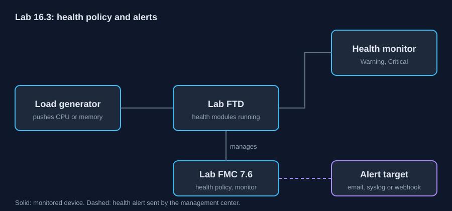

# Lab: Build a health policy that actually alerts someone

Video: [Health Policies and Health Monitoring in FMC](https://www.youtube.com/playlist?list=PLOQcyyK_fdoc)
Reference: Cisco Secure Firewall Management Center Administration Guide 7.6,
chapter "Health". Check the guide for your exact version.

> **Use a lab FMC/FTD or a virtual lab, never production.**

## Goal

Find device problems before users do. You copy the default health policy, lower a CPU or memory threshold, apply it to a lab device, create a health monitor alert for Warning and Critical, generate load and confirm both the status change and the alert.

## Background

- Health modules are tests that run at an interval. Alert modules report a status; metrics modules collect time-series data and some also alert on thresholds.
- Statuses are Error, Critical, Warning, Normal, Recovered and Disabled. A module that does not apply to an appliance shows Disabled.
- Health monitor alerts connect severities and modules to an alert response such as email or a webhook.
- Exclusions temporarily disable monitoring for a device or module, for example during maintenance.

## Prerequisites

- A lab management center and threat defense (never production).
- A working alert response target (lab mail relay, syslog or webhook).

Values you will use (keep them as placeholders in anything you share, never commit real values):

| Placeholder | What it is |
|---|---|
| `<POLICY_NAME>` | the copied lab health policy |
| `<DEVICE_NAME>` | the lab threat defense |
| `<ALERT_TARGET>` | the lab alert response target |

## Steps

### Part 1: the policy

1. Go to **System > Health > Policy**, copy the default policy and name it `<POLICY_NAME>`.
2. Lower a CPU or memory threshold to a value `<DEVICE_NAME>` will cross under test load.
3. Apply the policy to `<DEVICE_NAME>` and deploy.

### Part 2: the alert

4. Create an alert response that sends to `<ALERT_TARGET>`.
5. Go to **System > Health > Monitor Alerts** and add an alert for Warning and Critical on the module you changed.

### Part 3: prove it

6. Generate load on `<DEVICE_NAME>` and watch **System > Health > Monitor**.
7. Confirm the status change and the alert at `<ALERT_TARGET>`.

## Where this lab follows the documentation

A health event by itself does not notify anyone. Notification needs a health monitor alert that links a severity and modules to an alert response. Managed devices report only after a health policy is deployed to them, and modules added by an upgrade must be reapplied.

## Check your work

Use [checklist.md](checklist.md). If something does not work, start with
[troubleshooting.md](troubleshooting.md).

## Clean up

Restore the normal threshold, deploy, remove test alerts and any exclusions.

---
*Always confirm behavior against the guide for your exact FMC/FTD version. Independent training by Hexward Labs; not affiliated with or endorsed by Cisco Systems.*
