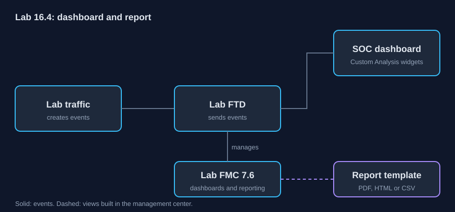

# Lab: Build a SOC dashboard tab and a scheduled report

Video: [Dashboards and Reports in Secure Firewall Management Center](https://www.youtube.com/playlist?list=PLOQcyyK_fdoc)
Reference: Cisco Secure Firewall Management Center Administration Guide 7.6,
chapters "Dashboards" and "Reports". Check the guide for your exact version.

> **Use a lab FMC/FTD or a virtual lab, never production.**

## Goal

Give the SOC a view it uses and give managers a document they read. You create a dashboard with two Custom Analysis widgets, then build a report template with an intrusion section and a connection section, preview it and generate a PDF.

## Background

- Dashboards are managed under Overview > Dashboards > Management. The Summary Dashboard is the default home page.
- The dashboard time range controls the data shown and how often widgets refresh.
- To show one device only, create a saved search for it and constrain a Custom Analysis widget with that search.
- Report templates are made of sections; each section is a search shown as a table, chart or detail view, and the report is generated as PDF, HTML or CSV. Templates can be created from scratch, copied, created from an event view or built by importing a dashboard or workflow section.

## Prerequisites

- A lab management center with events from a lab threat defense (never production).
- Optional: a lab mail relay to test emailing reports.

Values you will use (keep them as placeholders in anything you share, never commit real values):

| Placeholder | What it is |
|---|---|
| `<DASHBOARD_NAME>` | your lab dashboard |
| `<TEMPLATE_NAME>` | your lab report template |

## Steps

### Part 1: dashboard

1. Choose **Overview > Dashboards > Management**, click **Create Dashboard**, name it `<DASHBOARD_NAME>` and save.
2. Add a tab and use **Add Widgets** to add a Custom Analysis widget for intrusion events by priority and one for connection events by application.
3. Set the dashboard time range and confirm the widgets populate.

### Part 2: report

4. Choose **Overview > Reporting**, open **Report Templates** and click **Create Report Template** named `<TEMPLATE_NAME>`.
5. Add a section for intrusion events and one for top connections, then click **Preview** for each section.
6. Save, generate the report as PDF and open it from the Reports tab.

## Where this lab follows the documentation

A dashboard tab holds up to 15 widgets and widgets cannot be moved between tabs. A Custom Analysis widget shaded red is slowing the system and should be removed. Emailing reports needs a mail relay host configured first.

## Check your work

Use [checklist.md](checklist.md). If something does not work, start with
[troubleshooting.md](troubleshooting.md).

## Clean up

Delete the lab dashboard, template and generated report if you do not want to keep them.

---
*Always confirm behavior against the guide for your exact FMC/FTD version. Independent training by Hexward Labs; not affiliated with or endorsed by Cisco Systems.*
