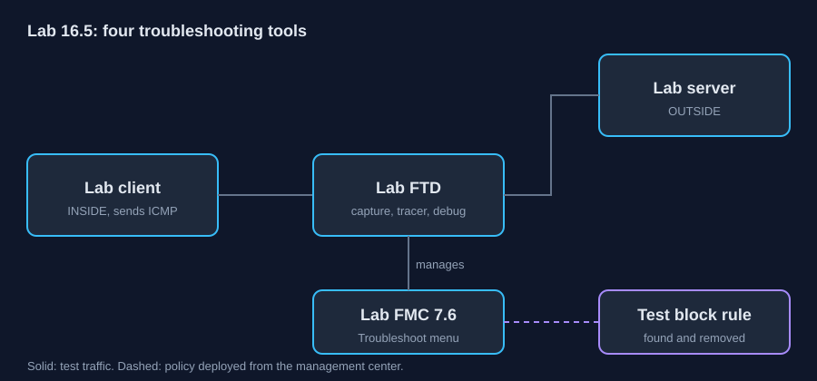

# Lab: Four troubleshooting tools, one blocked flow

Video: [Troubleshooting FTD: Packet Capture, Packet Tracer, Firewall Engine Debug and System Support Trace](https://www.youtube.com/playlist?list=PLOQcyyK_fdoc)
Reference: Cisco Secure Firewall Management Center Administration Guide 7.6,
chapter "Troubleshooting"; Cisco TechNotes 212474 and 214572. Check the guide for your exact version.

> **Use a lab FMC/FTD or a virtual lab, never production.**

## Goal

Prove where and why traffic is dropped instead of guessing. You block ICMP with a test rule, then use ingress and egress captures, packet tracer, firewall-engine-debug and system support trace, and compare what each one tells you.

## Background

- Packet capture answers: did the packet arrive on, and leave from, this interface?
- Packet tracer answers: what would the firewall do with this packet, phase by phase?
- `system support firewall-engine-debug` answers: which access control rule did Snort match, and why?
- `system support trace` shows the decisions of every engine, including intrusion and network analysis policy.
- Captures use device memory and may hold sensitive data, so remove them after the test.

## Prerequisites

- A lab threat defense with an INSIDE and OUTSIDE interface (never production).
- A lab client on INSIDE and a lab server on OUTSIDE.

Values you will use (keep them as placeholders in anything you share, never commit real values):

| Placeholder | What it is |
|---|---|
| `<CLIENT_IP>` | the lab client on INSIDE |
| `<SERVER_IP>` | the lab server on OUTSIDE |

## Steps

### Part 1: break it

1. Create an access control rule that blocks ICMP from `<CLIENT_IP>` to `<SERVER_IP>` and deploy.

### Part 2: captures

2. Run `capture CAPI interface INSIDE match icmp host <CLIENT_IP> host <SERVER_IP>` and `capture CAPO interface OUTSIDE match icmp host <SERVER_IP> host <CLIENT_IP>`.
3. Ping from the client and compare `show capture CAPI` with `show capture CAPO`.
4. Run `capture CAPI2 interface INSIDE trace detail trace-count 100 match icmp host <CLIENT_IP> host <SERVER_IP>`, ping again and read `show capture CAPI2 packet-number 1 trace detail`.

### Part 3: decision tools

5. Run `packet-tracer input INSIDE icmp <CLIENT_IP> 8 0 <SERVER_IP>` and note the phase that drops the packet.
6. Run `system support firewall-engine-debug` with the client and server, ping again and identify the matching rule.
7. Run `system support trace`, ping again and compare with the engine debug.

### Part 4: fix and confirm

8. Remove the test rule, deploy and run packet tracer again until the result is allow.

## Where this lab follows the documentation

Packet tracer injects a virtual packet and shows what the firewall would do; a capture with trace records how real packets were processed. Neither replaces the other. TechNote 214572 recommends checking the data path in this order: ingress, DAQ, Security Intelligence, access control, SSL, active authentication, intrusion policy, network analysis policy.

## Check your work

Use [checklist.md](checklist.md). If something does not work, start with
[troubleshooting.md](troubleshooting.md).

## Clean up

Remove every capture (`no capture CAPI`, `no capture CAPO`, `no capture CAPI2`) and the test rule.

---
*Always confirm behavior against the guide for your exact FMC/FTD version. Independent training by Hexward Labs; not affiliated with or endorsed by Cisco Systems.*
