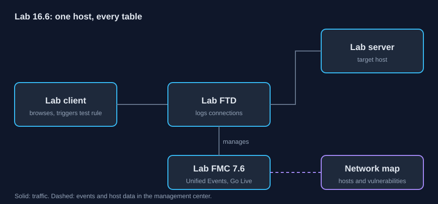

# Lab: Follow one host across every event table

Video: [Analyzing Events in FMC: Connection, Intrusion, Discovery, Unified Events and Network Map](https://www.youtube.com/playlist?list=PLOQcyyK_fdoc)
Reference: Cisco Secure Firewall Management Center Administration Guide 7.6,
chapters "Connection and Security-Related Connection Events", "Intrusion Events", "Unified Events" and "Network Map". Check the guide for your exact version.

> **Use a lab FMC/FTD or a virtual lab, never production.**

## Goal

Build a timeline for one host in minutes. You generate traffic and a harmless test intrusion event from a lab client, follow the client through Unified Events with Go Live, open the matching intrusion event, check the network map and save your search.

## Background

- Connection events: Analysis > Connections > Events. Security-related connection events are stored and pruned separately.
- Intrusion events: Analysis > Intrusions > Events, with impact levels from 1 (vulnerable) to 4 (unknown target).
- Unified Events combines connection, Security Intelligence, intrusion, file, malware and troubleshooting events; Go Live shows new events in real time.
- The network map (Analysis > Hosts > Network Map) shows the hosts, applications and vulnerabilities the system has learned.

## Prerequisites

- A lab management center and threat defense with end-of-connection logging and an intrusion policy (never production).
- A lab client and a lab server.

Values you will use (keep them as placeholders in anything you share, never commit real values):

| Placeholder | What it is |
|---|---|
| `<CLIENT_IP>` | the lab client |
| `<SERVER_IP>` | the lab server |

## Steps

### Part 1: generate

1. Confirm rules log at end of connection and an intrusion policy is applied; deploy.
2. From `<CLIENT_IP>`, browse to `<SERVER_IP>` and trigger a harmless test intrusion rule.

### Part 2: trace

3. Open **Analysis > Unified Events**, set a sliding 1-hour window, filter on `<CLIENT_IP>` and click **Go Live**.
4. Open the matching intrusion event and compare Initiator/Responder with Source/Destination and the impact level.
5. Open **Analysis > Hosts > Network Map** and find `<SERVER_IP>` with its applications and vulnerabilities.

### Part 3: keep it

6. Save the Unified Events filter as a favorite search and save a column set.

## Where this lab follows the documentation

Connection events name the two ends Initiator and Responder; intrusion events use Source and Destination. A session blocked by Security Intelligence has no file or intrusion data because it was never inspected. Graphs and connection summaries are built from end-of-connection logs.

## Check your work

Use [checklist.md](checklist.md). If something does not work, start with
[troubleshooting.md](troubleshooting.md).

## Clean up

Remove any test intrusion rule changes and deploy again.

---
*Always confirm behavior against the guide for your exact FMC/FTD version. Independent training by Hexward Labs; not affiliated with or endorsed by Cisco Systems.*
