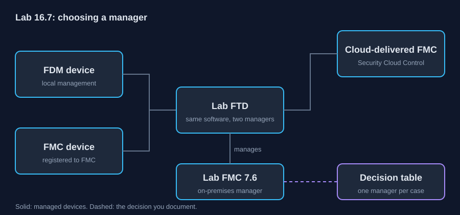

# Lab: Compare FDM and FMC and write a manager decision table

Video: [FMC vs FDM vs Security Cloud Control: Choosing the Right Firewall Manager](https://www.youtube.com/playlist?list=PLOQcyyK_fdoc)
Reference: Cisco Secure Firewall Management Center Administration Guide 7.6 and Secure Firewall Device Manager Configuration Guide 7.6,
"Firewall Management Center Overview" and "Getting Started"; Security Cloud Control documentation. Check the guide for your exact version.

> **Use a lab FMC/FTD or a virtual lab, never production.**

## Goal

Choose a manager on purpose, not by habit. You configure one virtual threat defense in FDM, register another to a lab FMC, compare deployment and event workflows, and write a one-page decision table that also covers cloud-delivered FMC.

## Background

- FMC (on-premises) manages many devices from an appliance you operate.
- FDM is built into the device and manages only that device; its CLI Console offers read-only troubleshooting commands such as `show route` and `packet-tracer`.
- Cloud-delivered FMC runs in Security Cloud Control and manages many devices with the FMC look and API.
- An on-premises FMC can act as an analytics-only manager when cloud-delivered FMC is the primary manager.

## Prerequisites

- Two virtual threat defense instances and a lab FMC (never production).

Values you will use (keep them as placeholders in anything you share, never commit real values):

| Placeholder | What it is |
|---|---|
| `<FDM_DEVICE>` | the threat defense managed by FDM |
| `<FMC_DEVICE>` | the threat defense managed by FMC |

## Steps

### Part 1: FDM

1. Log in to FDM on `<FDM_DEVICE>`, complete the setup wizard and deploy a simple access rule.
2. Open the CLI Console and run `show route` and a `packet-tracer` test.
3. Note the FDM user roles and the audit log location (Device > Device Administration > Audit Log).

### Part 2: FMC

4. Register `<FMC_DEVICE>` to the lab FMC and deploy an equivalent policy.
5. Compare deployment, event views and multi-device features with FDM.

### Part 3: decide

6. Write a decision table for your environment: device count, sites, need for on-premises data, staff skills, and which manager you would pick for each case.

## Where this lab follows the documentation

A device managed by the management center is not configured directly; the management center owns its configuration. Cloud-delivered FMC uses the same FMC API, needs no license of its own (devices still need licenses) and supports threat defense 7.0.3+ in 7.0.x and 7.2+, not 7.1.

## Check your work

Use [checklist.md](checklist.md). If something does not work, start with
[troubleshooting.md](troubleshooting.md).

## Clean up

Return both lab devices to your baseline.

---
*Always confirm behavior against the guide for your exact FMC/FTD version. Independent training by Hexward Labs; not affiliated with or endorsed by Cisco Systems.*
