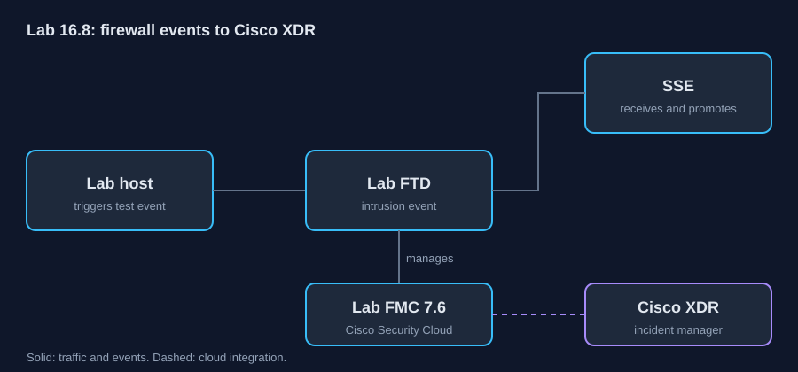

# Lab: Send firewall events to Cisco XDR

Video: [Cisco XDR Integration with Secure Firewall](https://www.youtube.com/playlist?list=PLOQcyyK_fdoc)
Reference: Cisco Secure Firewall Threat Defense and Cisco XDR Integration Guide; Cisco Secure Firewall Management Center Administration Guide 7.6,
"Event Analysis Using External Tools". Check the guide for your exact version.

> **Use a lab FMC/FTD or a virtual lab, never production, and use a trial or lab XDR tenant.**

## Goal

Get firewall events into one investigation. You confirm the cloud services in SSE, enable the cloud integration on a 7.6 management center, choose the event types, trigger a test intrusion event and find it in SSE and in XDR.

## Background

- Cisco XDR correlates telemetry from several products into incidents and is licensed separately.
- Security Services Exchange (SSE) receives device events and promotes them to XDR, automatically or manually.
- Events can be sent directly to the regional cloud or as syslog through an on-premises Security Services Proxy. Data cannot be merged across regional clouds.
- Event types sent to the cloud: intrusion, security-related connection, and file and malware events.

## Prerequisites

- A 7.6 lab management center and threat defense with outbound HTTPS to the regional cloud (never production).
- A lab Security Cloud Control tenant with XDR.

Values you will use (keep them as placeholders in anything you share, never commit real values):

| Placeholder | What it is |
|---|---|
| `<REGION>` | the regional cloud for your tenant |
| `<TENANT>` | the lab Security Cloud Control tenant |
| `<CLIENT_IP>` | the lab host that triggers the test event |

## Steps

### Part 1: prepare

1. In SSE, confirm Cisco XDR and Eventing are enabled under Cloud Services.

### Part 2: link the management center

2. Choose **Integration > Cisco Security Cloud**, select `<REGION>` and click **Enable Cisco Security Cloud**.
3. Sign in to `<TENANT>` in the new tab, check the verification code matches, click **Authorize FMC** and save.
4. Check **Send events to the cloud**, select intrusion, security-related connection, and file and malware events, and save.

### Part 3: prove it

5. Trigger a test intrusion event from `<CLIENT_IP>`.
6. Find the event on the SSE Events tab, then find the promoted event in the XDR incident manager.

## Where this lab follows the documentation

The menu name depends on the management center version: Integration > SecureX (7.0.2 to 7.4.x), Integration > Cisco Security Cloud (7.6.0 to 7.7.x), Integration > Security Cloud Control (10.0 and later). Direct integration is not supported with Smart Software Manager On-Prem or air-gapped deployments, and sending the same events by direct integration and syslog creates duplicates.

## Check your work

Use [checklist.md](checklist.md). If something does not work, start with
[troubleshooting.md](troubleshooting.md).

## Clean up

Disable the test integration or event sending if the tenant is temporary.

---
*Always confirm behavior against the guide for your exact FMC/FTD version. Independent training by Hexward Labs; not affiliated with or endorsed by Cisco Systems.*
