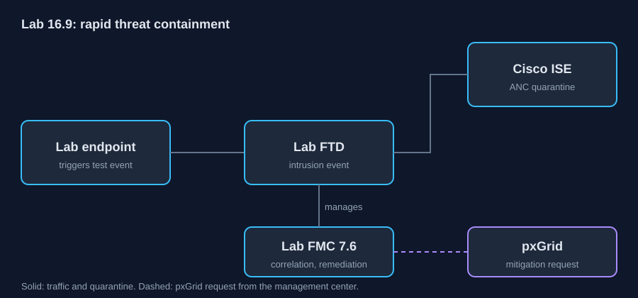

# Lab: Quarantine an endpoint through ISE from a correlation rule

Video: [Rapid Threat Containment: From FMC Correlation to ISE Quarantine](https://www.youtube.com/playlist?list=PLOQcyyK_fdoc)
Reference: Cisco Secure Firewall Management Center Administration Guide 7.6,
chapters "Remediations" and "Correlation Policies". Check the guide for your exact version.

> **Use a lab FMC/FTD or a virtual lab, never production, with a lab ISE.**

## Goal

Contain an endpoint without waiting for a person. You create a pxGrid Mitigation instance with a quarantine remediation, attach it to a correlation rule in an active policy, trigger the rule from a lab endpoint, confirm the quarantine in ISE and release it.

## Background

- Remediation modules include pxGrid Mitigation, Cisco IOS Null Route, Nmap Scanning and Set Attribute Value.
- An instance is a configured copy of a module (Policies > Actions > Instances); a remediation is the action inside it, applied to the source or destination of the event.
- Flow: event, correlation rule, correlation policy, remediation, pxGrid, ISE quarantine policy.
- A remediation status event records whether the action succeeded. You need the Admin or Discovery Admin role.

## Prerequisites

- A lab management center and threat defense integrated with a lab ISE over pxGrid (never production).
- ISE configured with an ANC quarantine policy and a lab endpoint authenticated through ISE.

Values you will use (keep them as placeholders in anything you share, never commit real values):

| Placeholder | What it is |
|---|---|
| `<ENDPOINT_IP>` | the lab endpoint to quarantine |
| `<INSTANCE_NAME>` | your pxGrid Mitigation instance |

## Steps

### Part 1: remediation

1. Confirm the pxGrid integration between ISE and the management center is up.
2. Choose **Policies > Actions > Instances**, add a **pxGrid Mitigation** instance named `<INSTANCE_NAME>` with logging enabled.
3. View the instance and add **Mitigate Source** with the action **quarantine**.

### Part 2: correlation

4. Create a correlation rule for a test intrusion event from `<ENDPOINT_IP>`.
5. Add it to a correlation policy, assign the remediation as the response and activate the policy.

### Part 3: prove it

6. Trigger the test event from `<ENDPOINT_IP>`.
7. Confirm the remediation status event and the quarantine in ISE, then unquarantine the endpoint.

## Where this lab follows the documentation

The remediation is launched by a correlation policy, not by the access control policy. ISE must be configured for EPS/ANC and integrated over pxGrid; ISE-PIC cannot perform these remediations. The pxGrid Mitigation actions are quarantine, unquarantine and shutdown.

## Check your work

Use [checklist.md](checklist.md). If something does not work, start with
[troubleshooting.md](troubleshooting.md).

## Clean up

Unquarantine the endpoint, deactivate the correlation policy and delete the test rule and instance.

---
*Always confirm behavior against the guide for your exact FMC/FTD version. Independent training by Hexward Labs; not affiliated with or endorsed by Cisco Systems.*
