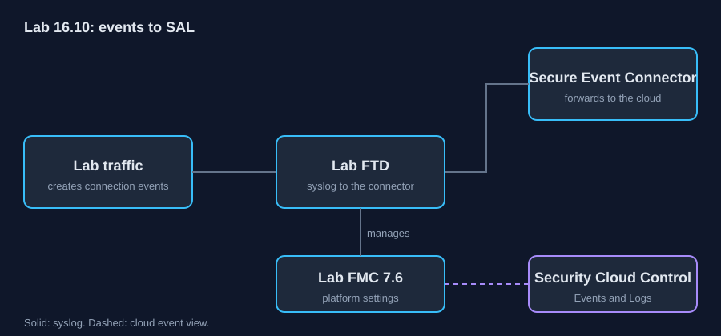

# Lab: Send FTD events to Security Analytics and Logging

Video: [Security Analytics and Logging: Sending FTD Events to the Cloud](https://www.youtube.com/playlist?list=PLOQcyyK_fdoc)
Reference: Firepower Management Center and Security Analytics and Logging (SaaS) Integration Guide; Cisco Secure Firewall Management Center Administration Guide 7.6,
"Event Analysis Using External Tools". Check the guide for your exact version.

> **Use a lab FMC/FTD or a virtual lab, never production, and use a SAL trial.**

## Goal

Keep firewall logs longer without filling the management center. You deploy a Secure Event Connector, point the device syslog at it with the required settings, log connections and Security Intelligence events to syslog, and find the events in Security Cloud Control.

## Background

- SAL stores firewall events in the cloud; they are viewed in Security Cloud Control.
- Syslog path: devices send syslog to an on-premises Secure Event Connector (SEC), which forwards to the cloud. Direct path: devices send events through Security Services Exchange.
- SAL is sized by daily ingest rate and retention; Secure Cloud Analytics adds analytics with an extra license.

## Prerequisites

- A lab management center and threat defense (never production).
- A SAL trial tenant in Security Cloud Control and a host for the Secure Event Connector.

Values you will use (keep them as placeholders in anything you share, never commit real values):

| Placeholder | What it is |
|---|---|
| `<SEC_ADDRESS>` | the Secure Event Connector address |
| `<SEC_PORT>` | the SEC syslog port |

## Steps

### Part 1: connector

1. In Security Cloud Control, deploy a Secure Event Connector and note `<SEC_ADDRESS>` and `<SEC_PORT>`.

### Part 2: device syslog

2. Choose **Devices > Platform Settings**, edit the policy and add `<SEC_ADDRESS>` on `<SEC_PORT>` as a syslog server.
3. Enable timestamps and the device ID, leave EMBLEM unchecked and save.

### Part 3: what to log

4. In the access control policy, use the platform settings syslog configuration and send Security Intelligence logging to syslog.
5. On each rule, log beginning and end of connection to the syslog server, then deploy.

### Part 4: prove it

6. Generate traffic and find the events in Security Cloud Control under **Events & Logs > Events**.

## Where this lab follows the documentation

EMBLEM format must not be selected, and secure syslog (TLS) is not supported on the syslog path. Timestamps and the device ID must be enabled. The direct path is not available with Smart Software Manager On-Prem, air-gapped or evaluation licenses.

## Check your work

Use [checklist.md](checklist.md). If something does not work, start with
[troubleshooting.md](troubleshooting.md).

## Clean up

Remove the syslog server and logging changes if the trial is temporary, then deploy.

---
*Always confirm behavior against the guide for your exact FMC/FTD version. Independent training by Hexward Labs; not affiliated with or endorsed by Cisco Systems.*
