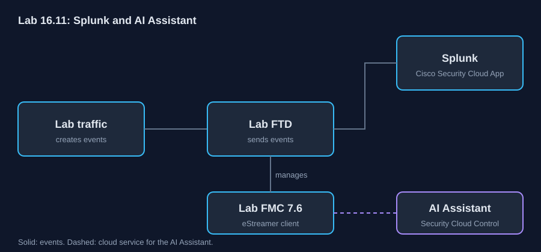

# Lab: Firewall events into Splunk, plus the AI Assistant

Video: [Splunk Integration and AI Assistant for Secure Firewall](https://www.youtube.com/playlist?list=PLOQcyyK_fdoc)
Reference: Cisco Security Cloud App for Splunk User Guide; Cisco TechNote 226077; Cisco Secure Firewall Management Center Administration Guide 7.6,
"Event Analysis Using External Tools". Check the guide for your exact version.

> **Use a lab FMC/FTD or a virtual lab, never production, with a lab Splunk instance.**

## Goal

Put firewall events where the SOC already works. You create an eStreamer client on the management center, configure the Cisco Security Cloud App input in Splunk, search the events, then enable the AI Assistant and ask it a policy question.

## Background

- The Cisco Security Cloud App brings data from Cisco security products into Splunk. Secure Firewall inputs include eStreamer, syslog and the Firewall API.
- eStreamer clients are created under Integration > Other Integrations > eStreamer, where you choose event types and download the client certificate.
- App health is shown in the Data Integrity and Resource Utilization dashboards.
- The AI Assistant is enabled under Integration > Cisco Security Cloud.

## Prerequisites

- A lab management center and threat defense (never production).
- A lab Splunk instance and, for the AI Assistant, a 7.6 management center with a Security Cloud Control trial.

Values you will use (keep them as placeholders in anything you share, never commit real values):

| Placeholder | What it is |
|---|---|
| `<SPLUNK_HOST>` | the lab Splunk host or heavy forwarder |
| `<INDEX_NAME>` | the Splunk index for firewall events |
| `<CERT_PASSWORD>` | the eStreamer certificate password (never commit it) |

## Steps

### Part 1: eStreamer client

1. Choose **Integration > Other Integrations > eStreamer**, select the event types and create a client for `<SPLUNK_HOST>`.
2. Download the client certificate and keep `<CERT_PASSWORD>` out of shared files.

### Part 2: Splunk input

3. In Splunk install the Cisco Security Cloud App and open **Application Setup**.
4. Choose Secure Firewall and configure an eStreamer input with the certificate, password, `<INDEX_NAME>` and interval.
5. Generate traffic and search `<INDEX_NAME>` for firewall events.

### Part 3: AI Assistant

6. Choose **Integration > Cisco Security Cloud** and check **Enable Cisco AI Assistant for Security**.
7. Open the AI Assistant and ask a question about your access control policy.

## Where this lab follows the documentation

In a distributed Splunk deployment the inputs run on a heavy forwarder and the indexes are defined on the indexer cluster. The AI Assistant needs management center 7.6 or later, a Security Cloud Control subscription, outbound internet and the Administrator role; it is not available on an HA standby and policy data syncs up to every 24 hours.

## Check your work

Use [checklist.md](checklist.md). If something does not work, start with
[troubleshooting.md](troubleshooting.md).

## Clean up

Remove the lab eStreamer client and Splunk input if you do not keep them.

---
*Always confirm behavior against the guide for your exact FMC/FTD version. Independent training by Hexward Labs; not affiliated with or endorsed by Cisco Systems.*
